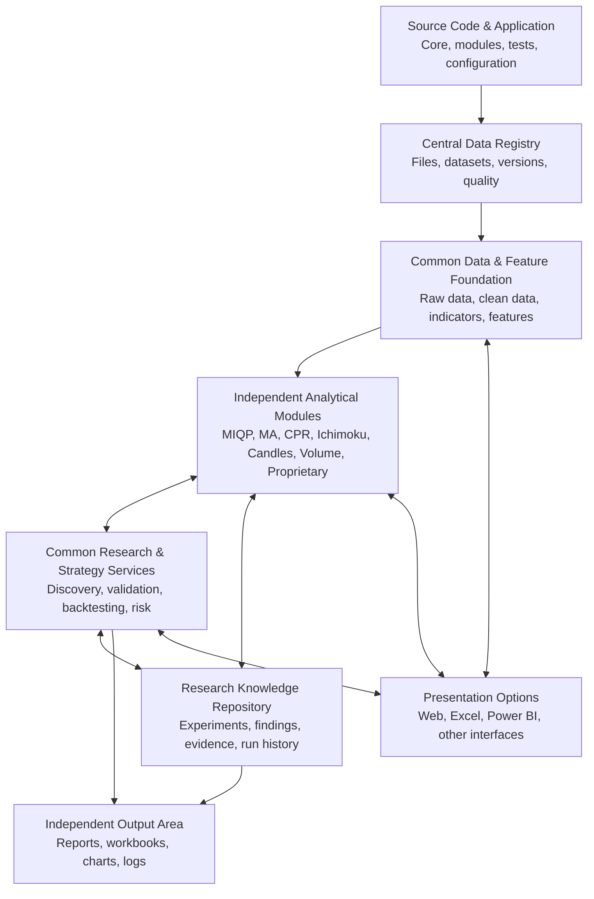
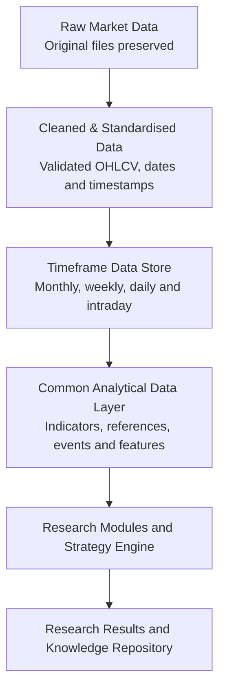
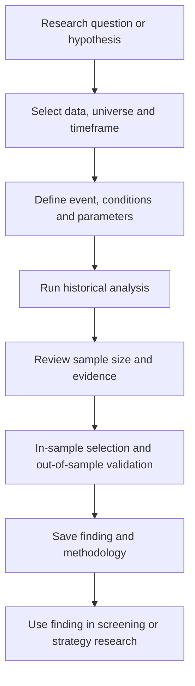

# Q-MAP


## Version Supersession and Authority

Q-MAP Master Blueprint v1.2 supersedes and replaces Master Blueprint v1.1 and v1.0 as the current authoritative architecture and product reference for Q-MAP. All future development must follow v1.2. Earlier versions are retained for historical reference only and must not be used as the governing specification where they differ from v1.2. All previously approved requirements remain applicable unless explicitly amended or superseded in v1.2. Supersession of earlier versions does not mean that previously approved functionality or requirements are automatically discarded.

If a conflict, ambiguity, or important missing requirement is identified, it must be flagged for the Project Owner rather than silently reverting to an earlier version or inventing a resolution.

## Quantitative Market Analytics Platform

### Master Project Intent, Requirements & Architecture Blueprint

**Document version:** 1.2\
**Status:** Proposed revised product and architecture baseline ---
pending Project Owner review and approval\
**Prepared:** 1 November 2026\
**Document purpose:** Explain what Q-MAP is intended to do, how its
parts fit together, how it should be used, and the principles that
should guide future development.

> **In plain English:** Q-MAP is one integrated quantitative research
> platform. It brings together market intelligence, price-behaviour
> research, opportunity discovery, strategy backtesting and
> portfolio-risk analysis. New research ideas and timeframes can be
> added over time without rebuilding the platform.

------------------------------------------------------------------------

## Version 1.2 change summary

Version 1.2 preserves the substantive intent of v1.1 and incorporates
the architecture and application-design decisions discussed after that
revision. It is a proposed revision for Project Owner review; it does
not itself authorise code changes or claim that the design is already
implemented.

Key changes and clarifications: - Q-MAP is organised at the top level
around two major modules: the **Database Module** and the **Analytical
Module**. - The Database Module is a prerequisite for analysis: the
Analytical Workbench must verify that the data required for a requested
analysis is registered, accessible, sufficiently complete and suitable.
The dependency is on the readiness of the specific required data, not
merely on whether a database exists. - Q-MAP will have two separate user
interfaces: **Database Manager** and **Analytical Workbench**. - The
target application layout is one shared `Q-MAP_APP` folder with two main
Python entry points---`database_manager.py` and
`analytical_workbench.py`---and shared plus specialised supporting
components. The exact internal folder layout is subject to an audit of
the current code before implementation. - The two GUIs are separate
entry points into one integrated platform. They share the Data Registry,
common data definitions, eligible calculations and other common
infrastructure; they are not separate, disconnected products. - The
Database Manager prepares, standardises, validates, registers and
manages datasets. The Analytical Workbench selects and runs research
against prepared datasets; it does not independently interpret arbitrary
source files as part of its normal research workflow. - Original source
files must not be modified by Q-MAP. Retention and deletion are separate
policy choices; "untouched" means no alteration of source contents, not
an automatic promise of indefinite retention. - Daily OHLCV is the
baseline market-data layer. Minute-level data is initially focused on
approximately 4--5 regularly used indices, and hourly data may be
maintained for a selected universe of approximately 200--500 stocks.
These are planning parameters, not fixed limits or evidence that data is
already available. - Weekly, monthly, quarterly and yearly data may be
derived from daily data under defined aggregation rules. Other derived
timeframes should be generated as needed, with commonly used datasets
eligible for retention where useful. - Permanent and Temporary are
user-controlled storage classifications. Temporary data remains
available until the user chooses to delete it; no automatic expiry is
assumed initially. Moving or deleting managed datasets must update the
registry and check known dependencies. Original source files are not to
be overwritten. - Parquet remains the proposed durable market-data
format, DuckDB the analytical query engine and SQLite the initial
metadata/registry option, subject to technical validation. Data updates
must handle duplicates and conflicts explicitly rather than blindly
appending. - The next development step is an implementation audit and
migration proposal, not an immediate rewrite. Existing working
functionality should be preserved wherever possible. - Implementation
status must be verified from code, tests and practical acceptance; this
Blueprint describes intended behaviour, not proof of delivery.

## Version authority and supersession

**Version 1.2 is proposed as the next revision of Q-MAP Master
Blueprint. It becomes the governing reference only when the Project
Owner explicitly approves and adopts it.** Until then, v1.2 is a
proposed revision for review and v1.1 remains the most recent prior
baseline, subject to its own approval status.

Versions 1.0 and 1.1 must be retained as historical records and must not
be deleted from project history. Once v1.2 is adopted, it becomes the
primary reference for new development, implementation audits,
requirements assessments and future changes where it clarifies, replaces
or conflicts with earlier versions. Historical work should still be
interpreted in the context of the version and decisions that applied
when that work was performed.

The canonical approved copy should be maintained in the designated Q-MAP
GitHub repository location. Copies stored elsewhere should identify
their version and approval status and should not silently diverge from
the canonical copy.

Superseding a Blueprint does **not** automatically approve code changes,
alter previously approved research methodologies, authorise an
architectural redesign, or approve a pull request. Differences between
the Blueprint and the current implementation must be documented as
findings and reviewed through the normal project workflow. Material
changes remain subject to Project Owner review and approval.

### Controlled document-change rules

For each material Blueprint revision:

1.  Increment the document version and update the preparation/revision
    date.
2.  Summarise the purpose and material changes near the beginning of the
    document.
3.  Add a version-history entry recording the version, date, change
    summary and approval/adoption status.
4.  Preserve prior versions and repository history; mark superseded
    copies clearly rather than deleting historical records.
5.  Identify affected requirements, modules, supporting documents and
    implementation work where relevant.
6.  Distinguish proposed requirements from implemented, tested and
    owner-accepted capabilities.
7.  Record material decisions with their rationale, owner approval
    status and any follow-up work.
8.  Update both Markdown and HTML copies together and verify that their
    version metadata and substantive content agree.

Minor editorial corrections that do not change requirements may be
recorded as maintenance changes in the repository history. Changes to
scope, architecture, data policy, research methodology or acceptance
criteria require explicit review and an appropriate change record.

## How to read this document

This is the main intent and architecture reference for Q-MAP. It is
deliberately written in plain English rather than as a detailed software
engineering specification.

-   **Existing** means functionality found in the supplied QLOPB source
    files.
-   **Previously specified** means functionality described in the
    supplied MIQP documents, but not necessarily implemented.
-   **Proposed** means a recommended part of the future Q-MAP design.
-   **Open decision** means the owner must decide before the relevant
    implementation is finalised.

The document describes the target platform. It does not claim that all
proposed features already exist.

## Contents

1.  [Executive overview](#1-executive-overview)
2.  [Why Q-MAP is being created](#2-why-q-map-is-being-created)
3.  [What the platform should
    answer](#3-what-the-platform-should-answer)
4.  [The overall platform](#4-the-overall-platform)
5.  [Application windows and how they are
    used](#5-application-windows-and-how-they-are-used)
6.  [Independent research modules](#6-independent-research-modules)
7.  [How modules share and reuse
    work](#7-how-modules-share-and-reuse-work)
8.  [Data architecture and
    timeframes](#8-data-architecture-and-timeframes)
9.  [Source code, data and output
    separation](#9-source-code-data-and-output-separation)
10. [Research workflow and
    backtesting](#10-research-workflow-and-backtesting)
11. [Front-end choices](#11-front-end-choices)
12. [Technology direction in plain
    English](#12-technology-direction-in-plain-english)
13. [Research integrity and quality
    controls](#13-research-integrity-and-quality-controls)
14. [How existing QLOPB and MIQP work will be carried
    forward](#14-how-existing-qlopb-and-miqp-work-will-be-carried-forward)
15. [Development roadmap](#15-development-roadmap)
16. [Project governance and working
    principles](#16-project-governance-and-working-principles)
17. [Open decisions](#17-open-decisions)
18. [Glossary](#18-glossary)

------------------------------------------------------------------------

# 1. Executive overview

Q-MAP stands for **Quantitative Market Analytics Platform**.

It is intended to become a personal, extensible historical market
analytics and quantitative research environment. Its primary purpose is
to investigate market behaviour systematically, test hypotheses against
historical data, compare scenarios and combinations of conditions, and
inspect the evidence behind the results.

Suitable research findings may later be reused to scan existing
historical data for instruments meeting defined conditions. The initial
platform does not require live data, broker connectivity or trade
execution. Hypothetical historical entries, exits, targets, stops and
costs may be simulated when needed for analytical evaluation.

Q-MAP brings together two existing bodies of work:

-   **MIQP --- Market Intelligence & Query Platform:** the market-wide
    view of indices, market regime, breadth, sectors, relative strength
    and stock intelligence.
-   **QLOPB --- Quant Lens on Price Behaviour:** the focused study of
    how price behaves around moving averages and other technical
    reference points.

They should become two major analytical capabilities within one
platform, rather than two separate applications.

The platform should also support future research modules such as
moving-average variants, RSI, MACD, stochastic and other oscillators,
ATR and volatility, Bollinger Bands, traditional/Fibonacci/Camarilla
pivots, CPR, candlestick behaviour, volume-price analysis, breakouts,
pullbacks, reversals, consolidation, opening-range behaviour, relative
strength and the owner's own proprietary formulas and observations. This
list is illustrative and extensible; no module needs to be activated or
built until it is useful.

### The four central questions

  -----------------------------------------------------------------------
  Question                            Q-MAP capability
  ----------------------------------- -----------------------------------
  What market behaviour repeats, and  Historical research and scenario
  under what conditions?              testing

  Which conditions or combinations    Shared analytical components and
  have useful evidence?               research engine

  Which instruments meet selected     Historical-data scanner
  research rules at a historical      
  date?                               

  How would precisely defined         Strategy backtesting and validation
  hypothetical rules have behaved?    

  How can I inspect and reproduce the Research Library, run history,
  evidence?                           charts and reports
  -----------------------------------------------------------------------

### What Q-MAP is --- and is not

Q-MAP is a historical market analytics, quantitative research and
decision-support platform. It is not initially intended to be a
live-data service, automated trading bot, broker execution system or
live position manager.

Its calculations and research results must work without AI. AI may help
explain findings, help formulate research questions or assist with
documentation, but it must not invent calculations or replace the
research engine.

------------------------------------------------------------------------

# 2. Why Q-MAP is being created

The original projects address related but different needs.

  -----------------------------------------------------------------------
  Existing project        Main question it        Intended role in Q-MAP
                          addresses               
  ----------------------- ----------------------- -----------------------
  MIQP                    What is happening       Market Intelligence
                          across the market,      
                          sectors and stocks?     

  QLOPB                   How has price behaved   Price Behaviour
                          around a chosen         Research
                          technical reference?    
  -----------------------------------------------------------------------

Keeping them as unrelated applications would lead to duplicated data
handling, calculations, maintenance and research records. Combining
every calculation into one tightly connected program would make it
difficult to add or change research methods safely.

The preferred approach is therefore:

**One platform, one shared foundation, independent analytical modules
and a common way to store and reuse results.**

The modules should be able to operate independently. They should also be
able to use another module's approved data or findings when a research
question requires it.

------------------------------------------------------------------------

# 3. What the platform should answer

Q-MAP should support the following types of questions.

### Market questions

-   Is the overall market bullish, bearish, sideways or transitioning?
-   Is market breadth improving or deteriorating?
-   Which sectors are gaining or losing relative strength?
-   Is market leadership broadening or narrowing?
-   How does the current market compare with earlier periods?

### Stock questions

-   Which stocks have strong price structure and relative performance?
-   Which stocks are improving or weakening?
-   Which stocks are leading their sectors?
-   What is the stock's current relationship with important technical
    references?
-   What evidence supports its ranking or classification?

### Price-behaviour questions

-   What tends to happen after price touches or crosses a moving
    average?
-   Does the behaviour change when the moving average is rising or
    falling?
-   Does a CPR breakout behave differently in a trending market?
-   How do candlestick patterns behave in different market regimes?
-   Does an Ichimoku Cloud interaction have a different outcome when
    other conditions agree?
-   Do the owner's proprietary observations have measurable historical
    support?

### Strategy questions

-   What exact entry and exit rules are being tested?
-   What would the historical trade record have looked like?
-   What are the returns, drawdowns, win rate and expectancy?
-   Does the result survive out-of-sample and walk-forward testing?
-   Does it remain useful after reasonable costs and execution
    assumptions?

------------------------------------------------------------------------

# 4. The overall platform

Q-MAP should be organised into layers. Each layer has a clear
responsibility. This keeps the system understandable and allows parts to
evolve without forcing a complete redesign.

## 4.1 Overall architecture



The diagram shows the main responsibilities and relationships. It is a
conceptual design, not a claim that these components have already been
built.

## 4.2 The layers in plain English

  -----------------------------------------------------------------------
  Layer                               What it does
  ----------------------------------- -----------------------------------
  Application and source code         Contains the programs, research
                                      modules, tests and settings

  Data registry                       Records which files and datasets
                                      are available, where they are
                                      stored and what they contain

  Data and feature foundation         Holds standardised market data and
                                      commonly used calculated values

  Analytical modules                  Conduct independent market and
                                      price-behaviour analysis

  Research and strategy services      Provide common methods for
                                      experiments, validation and
                                      trading-strategy tests

  Research repository                 Preserves findings, assumptions,
                                      evidence and experiment history

  Output area                         Stores reports and results
                                      separately from source code

  Presentation options                Allows different front ends to use
                                      the same analytical capabilities
  -----------------------------------------------------------------------

## 4.3 Design principles

1.  One integrated Q-MAP platform with two major functional modules:
    Database and Analytics.
2.  Two separate user interfaces: Database Manager and Analytical
    Workbench.
3.  The Database Module is a prerequisite; each analysis must check
    readiness of its own required data.
4.  Independent research modules, not one monolithic research program.
5.  Common data definitions and calculation standards.
6.  Reuse existing data, features and findings wherever valid.
7.  Keep engines independent of their GUIs and keep shared services
    reusable.
8.  Keep source code, managed data and generated outputs physically
    separate.
9.  Support additional research methods and timeframes without
    redesigning the foundation.
10. Make calculations and findings explainable and reproducible.
11. Build only the complexity justified by actual needs; audit before
    rewriting.

## 4.4 Two major modules and two separate GUIs

Q-MAP has two major functional modules:

1.  **Database Module** --- imports source data, interprets it using
    explicit source configurations, standardises and validates it,
    manages datasets and records their status in the Data Registry.
2.  **Analytical Module** --- runs MIQP, QLOPB and future quantitative
    research against suitable standardised datasets, and manages
    research outputs and reproducibility.

The Database Module is a prerequisite for the Analytical Module. This
does not mean every dataset must be complete before any analysis can
run. The Analytical Workbench checks the specific instruments, date
range, timeframe, columns and quality requirements needed by each
requested analysis. It may allow an analysis when its required data is
ready, even if unrelated datasets have not been prepared. It should
explain missing or unsuitable data and must not silently bypass relevant
quality controls.

The two user interfaces are:

-   **Database Manager GUI** --- used to prepare, validate, register,
    inspect and manage market data.
-   **Analytical Workbench GUI** --- used to select research modules,
    define parameters, run analysis and inspect results.

The GUIs are separate, but they are not separate products. They share
the Data Registry, canonical data definitions, common calculation
services where appropriate, configuration conventions and provenance
standards.

### Target application entry points

The current target is one `Q-MAP_APP` folder with two main Python
entry-point files:

-   `database_manager.py` --- launches the Database Manager GUI.
-   `analytical_workbench.py` --- launches the Analytical Workbench GUI.

Shared code and specialised database/analytical components sit alongside
these entry points. This is a target design, not a claim about the
current repository. The exact internal directory structure and module
boundaries must be confirmed by inspecting the existing code before
implementation. Optionally separate packaging or deployment arrangements
may be considered later if justified; they are not required for the
initial design.

The entry-point files launch interfaces; they should not contain the
full engines. Database processing and quantitative calculations belong
in reusable engine components so that GUI changes do not require
rewriting core logic and future automation remains possible.

### Data-readiness handshake

Before starting a run, the Analytical Workbench should verify, using the
Data Registry and the underlying files or query interface, that:

-   the required dataset is registered and its location is known;
-   required files are present and readable;
-   instrument, date coverage, timeframe and required columns match the
    analysis;
-   data-quality status and known limitations are visible and compatible
    with the analysis;
-   the requested calculation does not silently rely on missing, stale
    or incompatible data.

The registry alone is not proof that a file still exists or is readable.
Conversely, files found on disk should not be treated as approved
datasets without registration and appropriate validation. The database
workflow should publish a clear readiness status and relevant metadata
for the Analytical Workbench to consume.

### Development rule

Before changing the existing GUI or reorganising the code, the developer
must inspect the current implementation, map existing functions to the
two modules, identify reusable components and propose a migration plan.
No full rewrite should be assumed. Preserve working functionality where
it fits the target architecture, and use feature branches, pull
requests, tests and Project Owner approval before merging into `main`.

------------------------------------------------------------------------

# 5. Application windows and how they are used

The application should present a coherent set of windows. These are
functional areas, not necessarily separate programs.

## 5.1 Dashboard --- daily starting point

**Purpose:** Give a concise view of the market and highlight where
attention may be useful.

Expected content:

-   Major indices and their current market condition.
-   Market regime and breadth.
-   Strongest and weakest sectors.
-   Volatility context.
-   Stocks meeting saved screening criteria.
-   Recent research results and important data updates.

**Typical use:** Open Q-MAP, understand the broad environment and decide
which areas deserve further investigation.

## 5.2 Market Overview

**Purpose:** Examine the market as a whole.

Expected content:

-   Index trend and moving-average structure.
-   Market breadth, including the percentage of stocks above selected
    moving averages.
-   Advance/decline information and new highs/lows, where data is
    available.
-   Market volatility.
-   Market-regime classification.
-   Historical market conditions for a selected date.

**Typical use:** Establish whether the broader environment is
supportive, mixed or unfavourable for a particular type of trading.

## 5.3 Sector Explorer

**Purpose:** Identify where relative strength and weakness are
developing.

Expected content:

-   Sector performance over different periods.
-   Relative strength against the market.
-   Sector trend and breadth.
-   Sector rotation and historical comparisons.
-   Constituent stocks and their contribution to sector performance.

**Typical use:** Narrow the market to sectors that deserve closer
stock-level research.

## 5.4 Stock Explorer

**Purpose:** Provide a detailed profile of one instrument.

Expected content:

-   Daily, weekly and other available timeframe charts.
-   Price, volume and selected technical references.
-   Trend and stage classification.
-   Relative performance against the market and sector.
-   Relevant saved price-behaviour findings.
-   Evidence supporting classifications and rankings.

**Typical use:** Move from a market or sector observation to a detailed
assessment of an individual stock.

## 5.5 Opportunity Scanner

**Purpose:** Combine selected market, sector, stock and price-behaviour
conditions to identify candidates.

Example conditions:

  -----------------------------------------------------------------------
  Condition                           Potential source
  ----------------------------------- -----------------------------------
  Market regime is bullish            Market Intelligence

  Sector is outperforming             Sector Intelligence

  Stock has a favourable trend        Market Intelligence
  classification                      

  Price is above a rising moving      Common calculations
  average                             

  Historical pullbacks to that        Price Behaviour Research
  reference have favourable evidence  

  Volume confirms the condition       Volume Research
  -----------------------------------------------------------------------

The user should be able to save screening definitions, adjust conditions
and see why each stock qualified. The initial scanner operates on
existing historical data and can evaluate a chosen historical date or
data cut-off. Daily, weekly and monthly rules should use completed bars
when that is what the rule requires; an unfinished period must not be
treated as completed.

Rules and calculations should be reusable from research rather than
independently reimplemented in the scanner. The scanner may show that an
instrument meets a research rule, but should not imply a guaranteed
future outcome. If a research rule has limited or mixed evidence, that
limitation should remain visible.

A single composite score should not hide the underlying evidence.
Individual conditions and their contributions must remain visible.

## 5.6 Price Behaviour Lab

**Purpose:** Investigate historical price behaviour and test research
hypotheses.

Potential workbenches:

-   Moving-average interactions.
-   CPR and pivot behaviour.
-   Ichimoku Cloud behaviour.
-   Candlestick patterns and combinations.
-   Volume-price behaviour.
-   Breakouts, pullbacks, gaps and other price events.
-   Regime-conditioned and sector-conditioned research.
-   Proprietary observations.

A typical experiment should define the universe, timeframe, historical
period, event or condition, parameters, forward-return windows and
relevant evaluation approach. Results should include sample size and
evidence, not only a ranking.

The workbench should support both module-specific research and a
flexible general-purpose workflow that lets the owner combine compatible
analytical components. Examples include all-time-high breakouts with
trend, relative-strength, volume, volatility, market-regime or sector
conditions; pivot/CPR behaviour with candlestick patterns; or custom
indicators combined with standard features.

The system should make it practical to compare a baseline with
additional conditions, parameter values and combinations. It should not
assume that a more complex combination is better. Where practical, the
user should be able to drill from summary statistics into individual
historical cases and charts.

## 5.7 Strategy Backtesting Lab

**Purpose:** Test complete trading rules rather than only describe
historical price behaviour.

A strategy definition may include:

-   Eligible universe.
-   Market and sector filters.
-   Entry conditions.
-   Entry execution assumption.
-   Stop-loss and target.
-   Exit rules.
-   Position sizing.
-   Brokerage, taxes, slippage and other relevant costs.
-   Portfolio-level constraints.

Expected outputs include an equity curve, trade list, returns, CAGR,
drawdown, win rate, expectancy, risk-adjusted measures and robustness
results.

A completed price-behaviour study is not automatically a profitable
trading strategy. The strategy must be separately defined and tested.

## 5.8 Portfolio and Risk

**Purpose:** Understand the combined risk of positions and strategies.

Potential capabilities:

-   Position sizing.
-   Risk per trade.
-   Sector and instrument concentration.
-   Correlation between positions.
-   Portfolio exposure.
-   Drawdown and risk limits.
-   Strategy-level and portfolio-level performance.

This can begin with simulated portfolios. Live portfolio and broker
connections are not required for the initial platform.

## 5.9 Research Library

**Purpose:** Preserve the work already completed so that it can be found
and reused.

Each saved experiment or finding should record:

-   Research ID and title.
-   Originating module.
-   Research question.
-   Universe and timeframe.
-   Data period and dataset version.
-   Parameters and methodology version.
-   Sample size and results.
-   In-sample and out-of-sample evidence.
-   Status and limitations.
-   Related experiments or strategies.

Suggested lightweight, owner-controlled statuses:

  -----------------------------------------------------------------------
  Status                              Meaning
  ----------------------------------- -----------------------------------
  Under Research                      An idea is being investigated; this
                                      can include initial exploratory
                                      tests

  Promising                           Initial results look interesting,
                                      but the owner may want more
                                      evidence

  Validated                           The owner considers the evidence
                                      sufficient for the intended use

  Archived                            No longer actively used, but
                                      retained for history and
                                      reproducibility
  -----------------------------------------------------------------------

Statuses are labels, not mandatory workflow gates. The owner may change
a status directly, combine the practical meaning of statuses, return an
idea to research, or mark an idea validated based on work performed
elsewhere. Q-MAP may display useful cautions about sample size,
robustness or validation, but should not impose unnecessary
administrative steps.

The status records the owner's assessment; it does not guarantee that a
pattern will persist or that a strategy will be profitable. Technical
calculation validation, evidence about a research hypothesis and
permission to use a rule in scanning are distinct concepts and should
not be conflated.

## 5.10 Database Manager (Database GUI)

**Purpose:** Prepare and manage the data foundation used by all Q-MAP
research. This is a separate GUI and the first application to use when
new or updated market data must be prepared.

Expected capabilities:

-   Register and inspect source files and explicit source profiles.
-   Import supported file formats, including CSV, Excel and Parquet
    where implemented.
-   Standardise source data into Q-MAP's canonical market-data
    structure.
-   Identify and report duplicates, missing records, timestamp problems
    and OHLC/volume quality issues.
-   Maintain instrument, timeframe, source and relevant corporate-action
    metadata.
-   View data coverage and readiness by instrument, date range and
    timeframe.
-   Manage Permanent and Temporary datasets and report
    storage/processing status.
-   Preserve the original source file contents; never overwrite or
    silently alter an original.
-   Publish registry records and readiness information for the
    Analytical Workbench.

Data preparation should be explicit and auditable. The application must
not silently guess ambiguous date formats, volume meanings, timezones or
other material source semantics. It should report unresolved issues and
retain provenance for transformations.

## 5.11 Analytical Workbench (Analytical GUI)

**Purpose:** Provide the separate interface for research and analysis
using prepared, registered datasets.

Expected capabilities:

-   Select MIQP, QLOPB or another available research module.
-   Select instruments/universes, date ranges, timeframes and analytical
    parameters.
-   Check required dataset readiness before execution.
-   Run supported calculations and research without duplicating
    source-file interpretation logic.
-   Display findings, limitations, charts and reports.
-   Store each run's parameters, dataset references, code/method version
    where available, Run ID and outputs.
-   Explain which data is missing or unsuitable when a requested
    analysis cannot proceed.

The Analytical Workbench should not be responsible for general-purpose
source-file ingestion and standardisation. If data is missing, it should
explain the requirement and direct the user to the Database Manager
rather than silently creating an alternate data-preparation path.

------------------------------------------------------------------------

# 6. Independent research modules

New research ideas must be addable without rebuilding the platform.

## 6.1 Initial module catalogue

  -----------------------------------------------------------------------
  Module                  Main responsibility     Initial status
  ----------------------- ----------------------- -----------------------
  Market Intelligence     Market regime, breadth, Previously specified in
                          sectors and stock       MIQP
                          intelligence            

  MA Research             Moving-average          Existing QLOPB
                          interactions and        capability
                          affinity                

  CPR Research            Central Pivot Range     Planned; reference
                          behaviour               placeholders exist

  Pivot Research          Pivot levels and        Planned; reference
                          support/resistance      placeholders exist
                          behaviour               

  Ichimoku Research       Cloud, component        Proposed
                          relationships and price 
                          behaviour               

  Candlestick Research    Individual patterns and Proposed
                          combinations            

  Volume Research         Volume and price        Proposed
                          relationships           

  Proprietary Research    Owner-defined           Required extensibility
                          observations and        
                          hypotheses              

  Future modules          Any new quantitative    Extensible by design
                          research method         
  -----------------------------------------------------------------------

## 6.2 What every module should provide

Each module should have a consistent description and operating standard:

1.  What question does it investigate?
2.  What input data does it require?
3.  Which timeframes does it support?
4.  Which parameters can the user change?
5.  What calculations and events does it produce?
6.  What research outputs does it generate?
7.  How is its work validated?
8.  Which other modules may use its outputs?
9.  Which version of the module produced the result?

A module must be independently testable. It should not need to know the
internal code of another module.

Modules should expose clearly defined inputs, parameters, outputs,
timeframe assumptions and version information. Compatible outputs should
be usable by the common research engine and scanner. New ideas should be
added through a module or configuration using the common framework---not
by creating a separate bespoke application for every idea. Modules that
are not selected for use can remain dormant and should not consume
significant resources merely by existing.

Research must distinguish the chart/bar timeframe from the calculation
timeframe. For example, a weekly pivot or CPR value may be examined
against hourly bars, but only using the values that would have been
available at each historical point. Aggregation, exchange sessions,
holidays, shortened sessions, missing bars and timezones must be handled
consistently.

## 6.3 Example: Adding Ichimoku research

A future Ichimoku module could:

1.  Calculate the standard Ichimoku components.
2.  Identify price above, below or within the Cloud.
3.  Identify Cloud breakouts and interactions.
4.  Record relationships between price and the relevant components.
5.  Study forward returns after defined events.
6.  Compare behaviour under different market regimes and sectors.
7.  validate findings on data not used to select the hypothesis.
8.  Publish its results to the Research Library.

The same approach applies to a proprietary observation. The observation
must first be translated into clear, testable rules. It can then use the
common data, research and validation services.

------------------------------------------------------------------------

# 7. How modules share and reuse work

This is a central feature of Q-MAP.

**Independent does not mean isolated.** Modules should be able to use
standardised data and outputs from other modules without depending on
their internal implementation.

## 7.1 Example of combined research

Research question:

*What happens when a stock is in Stage 2, above a rising 50-day moving
average, above the Ichimoku Cloud and forms a bullish engulfing candle
near a selected reference?*

  Information required              Source
  --------------------------------- ----------------------------
  Stage classification              Market Intelligence
  50-day moving average and slope   Common Calculation Library
  Ichimoku Cloud position           Ichimoku Research
  Bullish engulfing event           Candlestick Research
  Subsequent returns                Common Research Framework
  Market-regime condition           Market Intelligence

The common research framework combines the conditions and evaluates the
resulting historical observations.

## 7.2 Common calculation library

Standard calculations should be implemented once and reused wherever
appropriate.

Examples include:

-   Moving averages.
-   ATR and volatility.
-   CPR and pivot calculations.
-   Volume averages.
-   Relative strength.
-   Standard price and return calculations.
-   Timeframe aggregation.

The definition of a calculation must be consistent. If a methodology
changes, the new version must be identified rather than silently
changing historical results.

## 7.3 Common Feature Store

Q-MAP should retain commonly used calculated values in a reusable
analytical store.

For example, the 50-day moving average for an instrument and date should
not be recalculated independently by MIQP, QLOPB and every new research
module.

The Feature Store should record enough information to identify:

-   Instrument.
-   Date and timeframe.
-   Feature name and value.
-   Calculation version.
-   Source data version.
-   Relevant parameters.

Modules should retrieve the feature when it is valid and current. They
should request recalculation when the data or methodology requires it.

## 7.4 Research findings are reusable too

The Research Library stores conclusions and evidence, not just raw
calculated values.

For example, a completed study of 30-week moving-average support
behaviour can be used by the Opportunity Scanner or a later strategy
experiment without rerunning the original research.

The receiving module must still check that the finding applies to its
requested universe, timeframe, period and methodology.

------------------------------------------------------------------------

# 8. Data architecture and timeframes

## 8.1 Data flow



The original uploaded data should be preserved. Cleaning and
standardisation should create managed versions rather than silently
changing the original file.

## 8.2 Supported timeframes

Q-MAP should be designed to support:

  Timeframe   Typical use
  ----------- -----------------------------------------------------
  Monthly     Long-term structure
  Weekly      Positional and trend research
  Daily       Swing trading and general research
  4-hour      Intermediate timeframe research
  1-hour      Short-term trading research
  30-minute   Intraday research
  15-minute   Intraday setups
  5-minute    Entry and execution research
  1-minute    Detailed intraday research, where data is available

The architecture should support these timeframes from the beginning.
They do not all need to be activated or populated immediately.

Each module must declare the timeframes it supports. A module designed
for daily data should not be assumed to work correctly on one-minute
data without appropriate validation.

## 8.3 Handling large data volumes

Intraday data can become much larger than daily data. Q-MAP should
therefore avoid loading entire historical datasets into memory or
placing every raw market record in one database file.

Proposed storage responsibilities:

  -----------------------------------------------------------------------
  Storage component                   Proposed role
  ----------------------------------- -----------------------------------
  Parquet files                       Durable storage for standardised
                                      historical market data and retained
                                      reusable datasets; organised by
                                      sensible dimensions/partitions
                                      rather than one database per stock

  DuckDB                              Analytical query engine over
                                      Parquet and other supported tabular
                                      data

  SQLite initially                    Application metadata, Data
                                      Registry, dataset status, settings
                                      and operational records, subject to
                                      technical validation

  PostgreSQL later, if justified      Larger multi-user or concurrent
                                      operational needs; not an initial
                                      requirement
  -----------------------------------------------------------------------

Permanent and Temporary are managed-data classifications, not different
analytical formats. The proposed Temporary location is
`Q-MAP_DATA/Temporary/`; the final directory layout should be confirmed
during implementation planning. Temporary datasets do not automatically
expire initially. The user chooses when to delete them.

The user should be able to change a managed dataset's classification
between Permanent and Temporary after an analysis has completed. Such a
move must update the Data Registry and any stored path references.
Before deletion or a move that may break access, Q-MAP should check
known dependencies and warn clearly. The application should not silently
break a saved research run or reusable feature's data lineage. Moving
data should not be confused with modifying its contents.

Permanent datasets should include the standardised historical market
data selected for ongoing use. The system should not automatically
retain every intermediate calculation or every possible timeframe.
Reusable features---such as moving averages, pivots, volume measures,
bands and average daily range---may be retained when useful, with their
definitions, parameters, source dataset/version and calculation
provenance recorded.

Updates must not blindly append new rows. Ingestion/update logic should
detect duplicates, overlaps and conflicts, apply an explicit approved
resolution policy, preserve provenance and report what was added,
changed, rejected or left unresolved. Raw originals must not be
overwritten. SQLite and the precise Parquet/DuckDB organisation remain
subject to a technical audit and validation against actual access
patterns.

## 8.4 Data quality and time alignment

The platform should check:

-   Missing and duplicate records.
-   Invalid or inconsistent OHLC values.
-   Date and timestamp formats.
-   Exchange sessions and trading calendars.
-   Timezone handling.
-   Corporate actions and price adjustments.
-   Instrument changes and symbol mapping.
-   Data coverage and gaps.

Higher-timeframe bars derived from intraday data must follow consistent
exchange-session and aggregation rules.

------------------------------------------------------------------------

# 9. Source code, data and output separation

This is a mandatory operating principle.

The source code, managed data and generated outputs must be stored
separately. Running a research experiment must not write reports into
the source-code folders or alter the original input data.

## 9.1 Proposed physical organisation

The intended top-level physical separation is:

``` text
Q-MAP/
    Q-MAP_DATA/
        Raw_Data/                 # optional source copies; contents never modified
        Permanent/                # retained standardised datasets/features
        Temporary/                # user-managed temporary datasets; no automatic expiry initially
        Reference_Data/
        Metadata/                 # registry/metadata storage, subject to implementation design

    Q-MAP_OUTPUT/
        Database_Reports/
        Analytical_Results/
        Research_Reports/
        Backtesting/
        Charts/
        Excel_Exports/
        Logs/

    Q-MAP_APP/
        database_manager.py       # Database Manager GUI entry point
        analytical_workbench.py   # Analytical Workbench GUI entry point
        common/                   # shared registry access, configuration, data access, utilities
        database_engine/          # ingestion, standardisation, validation and dataset management
        analytical_engine/        # shared analysis execution services
        miqp/                     # MIQP research capability
        qlopb/                    # QLOPB research capability
        tests/
        resources/
        documentation/

    Q-MAP_TEST_FILES/             # sample/acceptance-test files; not production data by default
```

This is a conceptual target layout. Names and boundaries are proposals,
not a demand to create every listed folder or file. Claude must inspect
the current repository and propose the smallest safe migration to
achieve the intended separation. Existing top-level folders shown in the
owner's current setup---`Q-MAP_DATA`, `Q-MAP_OUTPUT`, `Q-MAP_APP` and
`Q-MAP_TEST_FILES`---should be preserved unless a change is justified
and approved.

The two entry-point files launch separate GUIs, but the engine logic
should live in reusable supporting modules. Shared code should have one
maintained implementation rather than copied versions inside each GUI.
The database and analytical engines may have their own internal modules
while sharing the registry, configuration and canonical data
definitions.

Source code, managed data and outputs must remain separate. Actual
locations should be configurable. Do not assume that a sample/test
folder is a production-data store, and do not put generated reports or
market data inside the application source folder.

## 9.2 Run management

Every execution should receive a unique Run ID and a separate output
location.

For example:

``` text
Q-MAP_OUTPUT/
    Backtesting/
        BT_20261031_001/
            Run_Summary.xlsx
            Trade_Log.xlsx
            Equity_Curve.png
            Run_Metadata.json
            Execution_Log.txt
```

The exact files depend on the experiment.

A completed run should not silently overwrite an earlier run. If the
same experiment is repeated, the system should either retrieve the
existing valid result or create a new versioned run.

------------------------------------------------------------------------

# 10. Research workflow and backtesting

Q-MAP must distinguish between discovering a historical relationship,
scanning historical data for qualifying instruments, and testing a
complete hypothetical trading strategy.

## 10.1 Three connected capabilities

### Historical Research Lab

The Research Lab investigates hypotheses using historical OHLCV and
other registered datasets. It should support single conditions,
combinations, parameter sweeps, multiple instruments, historical
periods, market regimes and compatible timeframes. The owner should be
able to compare results, inspect historical examples and save the
experiment.

### Historical-data Scanner

The scanner applies selected, clearly defined rules to existing
historical data at a chosen historical date or data cut-off. It should
reuse the same calculations and rule definitions used by research
wherever compatible. It identifies instruments that meet the criteria;
it does not promise future performance.

### Strategy Backtesting

A backtest simulates a complete set of hypothetical historical rules,
including entry timing, exits, stops/targets, holding periods and
relevant costs where applicable. It is a separate analysis from
measuring a price pattern or scanning for conditions. It does not
require live execution.

The initial scope is historical data only. A future live-data source may
be considered separately, but the data-access design should avoid
unnecessarily coupling calculations to one data source. Live feeds,
broker connectivity, order routing and live position management are not
part of the initial scope.

## 10.2 Research workflow

The workflow is deliberately flexible rather than a mandatory sequence.
A user may record an idea, run exploratory tests, review results, adjust
parameters, mark a finding as promising or validated, and choose whether
to use it for scanning. Q-MAP should automate run records, provenance
and routine comparisons without requiring the user to administer a
complex process.

## 10.3 Example research flow



## 10.4 Price-behaviour research

Example: study how price behaves when it interacts with a rising 30-week
moving average.

The study could measure:

-   Number of qualifying interactions.
-   Positive and negative outcomes.
-   Average and median forward returns.
-   Return distribution.
-   Favourable and adverse price movement, where defined.
-   Differences across market regimes.
-   In-sample and out-of-sample consistency.

The output describes historical behaviour. It does not by itself prove
that a profitable trading strategy exists.

## 10.5 Strategy backtesting

A complete strategy test must define the actual trading rules.

Example:

  Rule              Illustrative definition
  ----------------- -----------------------------------
  Universe          Selected stock universe
  Market filter     Bullish regime
  Sector filter     Sector outperforming
  Stock filter      Defined trend condition
  Entry             Defined pullback and confirmation
  Execution         Next eligible trading session
  Stop-loss         Defined ATR-based rule
  Target            Defined reward-to-risk rule
  Position sizing   Fixed portfolio risk per trade
  Exit              Stop, target or time-based rule

These are example rules, not a validated trading system.

## 10.6 Validation requirements

Backtesting should address:

-   Chronological in-sample and out-of-sample separation.
-   Walk-forward testing.
-   Look-ahead bias.
-   Survivorship bias and historical constituent coverage.
-   Corporate actions and adjusted prices.
-   Brokerage, taxes, slippage and execution assumptions.
-   Overlapping signals and portfolio constraints.
-   Sensitivity to parameter changes.
-   Detailed trade-level records.

A strategy should not be labelled validated simply because its
historical return is attractive.

------------------------------------------------------------------------

# 11. Front-end choices

The database and analytical engines should be independent of their
respective user interfaces. Q-MAP will expose two separate GUIs:
Database Manager for data preparation/management, and Analytical
Workbench for research/analysis.

Python should perform the calculations, data transformations, validation
and backtesting. Each GUI should request work, display results and
provide user controls. The two GUIs share the same platform services and
data registry; neither should duplicate core calculations or maintain a
disconnected copy of dataset metadata.

## 11.1 Possible interfaces

  -----------------------------------------------------------------------
  Interface                           Potential use
  ----------------------------------- -----------------------------------
  HTML/web application                Main interactive research platform

  Excel                               Detailed result inspection,
                                      comparison and exports

  Power BI                            Market, sector and historical
                                      dashboards

  Desktop interface                   Local application experience, if
                                      preferred

  Other future interfaces             Can be added through the common
                                      application interface
  -----------------------------------------------------------------------

More than one interface may be used at the same time.

## 11.2 Shared application services and interfaces

A common service/interface layer should allow the two GUIs and any
future front ends or automated jobs to:

-   Request a dataset or analytical result.
-   Submit a research or backtesting job.
-   Check job status.
-   Retrieve results.
-   Export reports.
-   Access permitted settings and metadata.

A Python API layer, potentially using FastAPI, is a suitable option. The
final web framework and front-end choice remain open.

**Important:** Excel and Power BI should generally consume published
results or approved data interfaces. They should not contain separate
copies of the core research calculations.

------------------------------------------------------------------------

# 12. Technology direction in plain English

The following is a practical starting direction, not a requirement to
use every tool immediately.

  -----------------------------------------------------------------------
  Area                    Proposed choice         Why it is useful
  ----------------------- ----------------------- -----------------------
  Main development        Python                  Common language for all
  language                                        analytical modules

  Data manipulation       Pandas; Polars where    Clean and analyse
                          useful                  market data

  Historical data storage Parquet                 Efficient storage of
                                                  large datasets

  Analytical query engine DuckDB                  Analyse large datasets
                                                  without loading
                                                  everything into memory

  Metadata database       SQLite initially        Store settings,
                                                  registries and research
                                                  records simply

  Larger operational      PostgreSQL if justified Support more demanding
  database                                        multi-user needs

  Application interface   FastAPI or equivalent   Allow different front
                                                  ends to use the same
                                                  engine

  Charts                  Plotly or equivalent    Interactive financial
                                                  charts

  Testing                 Pytest or equivalent    Verify calculations and
                                                  prevent regressions

  Code management         Git                     Track code changes and
                                                  preserve versions
  -----------------------------------------------------------------------

The design should favour simple, dependable solutions. Additional
infrastructure should be introduced only when the actual workload
requires it.

------------------------------------------------------------------------

# 13. Research integrity and quality controls

The platform's usefulness depends on the quality of its data,
calculations and methodology.

The following rules should apply across all modules.

1.  **Deterministic calculations:** The same inputs, parameters and code
    version should produce the same results.
2.  **Independent verification:** Important calculations should be
    independently checkable, not hidden behind a dashboard.
3.  **Visible evidence:** Scores and rankings should show their
    underlying factors and supporting observations.
4.  **No look-ahead:** Historical calculations must use only information
    available at the time being tested.
5.  **No silent data changes:** Original input files remain preserved;
    cleaned data is separately identifiable.
6.  **Versioned methodology:** Changes to formulas or event definitions
    must be recorded.
7.  **Appropriate validation:** Research selection and final validation
    must use separate historical observations.
8.  **Honest status labels:** Insufficient evidence must not be
    presented as a negative result or as proof of failure.
9.  **Costs and execution:** Strategy tests must state their execution
    and cost assumptions.
10. **AI independence:** The platform's core calculations must work
    without AI.
11. **Scenario-comparison discipline:** Report sample sizes and useful
    baselines; do not assume additional filters improve a result.
12. **Multiple-testing caution:** When many parameter combinations are
    tried, make the exploratory nature visible and encourage
    separate-period or out-of-sample checks where practical.
13. **Historical scanner integrity:** A scan for a past date may use
    only data available at that date. Future data must not affect
    historical qualification.
14. **User-controlled workflow:** Status labels and research process
    should assist rather than constrain the owner.
15. **Evidence over labels:** A status such as Validated records the
    owner's judgment; supporting evidence and limitations remain
    accessible.

## 13.1 Reusing work without repeating it

Q-MAP should include a Research Run Manager and a result-reuse
mechanism.

When an experiment is requested, the system should check whether an
equivalent result already exists.

It should compare:

-   Dataset and data version.
-   Instrument universe.
-   Timeframe and date range.
-   Module and code version.
-   Calculation methodology.
-   Research parameters.

If all relevant inputs match, an existing result may be reused.

If data, methodology or parameters have changed, the system should
create a new run or recalculate the affected information.

Incremental processing should be used where practical. For example, when
new daily data arrives, the system should calculate the new affected
periods rather than unnecessarily rebuilding every historical feature.

A reused result must retain its original Run ID and provenance. The
system must not make an old result appear to have been generated using
newer data or code.

------------------------------------------------------------------------

# 14. How existing QLOPB and MIQP work will be carried forward

The new platform is a fresh project baseline, not a decision to discard
the existing work.

## 14.1 QLOPB

The supplied QLOPB repository contains a modular Python application,
data handling, timeframe preparation, reference calculations,
interaction and affinity analysis, validation, reports, a desktop
interface and tests.

The supplied README identifies MA Affinity as the implemented research
capability. Several other reference and combination areas are
placeholders.

Proposed treatment:

  -----------------------------------------------------------------------
  Existing capability                 Q-MAP treatment
  ----------------------------------- -----------------------------------
  Data loading and validation         Review and reuse

  Timeframe engine                    Review and reuse

  Moving-average calculations         Reuse after definition checks

  Interaction and affinity research   Preserve as Price Behaviour module

  IS/OOS validation                   Review, retain and strengthen

  Pivot and CPR placeholders          Complete within independent modules

  Reporting                           Reuse useful report logic

  Existing GUI                        Preserve during migration; replace
                                      or adapt after front-end decision

  Tests                               Retain and run as migration checks
  -----------------------------------------------------------------------

The supplied QLOPB project notes identify methodology items requiring
owner review, including Directed IR, scoring weights and boundary
handling. These should be resolved before the relevant methodology is
treated as final.

## 14.2 MIQP

The supplied MIQP material contains extensive concepts, principles,
technology choices, database specifications, phase specifications,
feature definitions, decisions and project logs.

It provides a useful design foundation for Market Intelligence and the
wider platform.

However, the supplied archive is primarily documentation and inventory
material; it does not establish that the full MIQP application has been
implemented.

Proposed treatment:

  -----------------------------------------------------------------------
  Existing MIQP work                  Q-MAP treatment
  ----------------------------------- -----------------------------------
  Market intelligence concepts        Retain and incorporate

  Market regime and breadth           Review and implement
  definitions                         

  Sector and stock intelligence       Retain as a major module

  Database and data specifications    Reconcile with the expanded data
                                      architecture

  Dashboard concepts                  Use as input to the front-end
                                      design

  Core principles                     Incorporate where consistent with
                                      the integrated architecture

  Older inventory and planning        Reconcile and archive where
  documents                           superseded
  -----------------------------------------------------------------------

## 14.3 Migration rule

The original QLOPB and MIQP project archives should remain preserved as
reference baselines.

Q-MAP should be established as the new parent project. Existing code
should be migrated incrementally, not rewritten by default.

Before a component is accepted into Q-MAP, its purpose, behaviour,
tests, dependencies and known limitations should be reviewed.

------------------------------------------------------------------------

# 15. Development roadmap

The roadmap should be staged. The objective is to establish a reliable
foundation before adding a large number of research modules.

  -----------------------------------------------------------------------
  Stage                   Main work               Expected outcome
  ----------------------- ----------------------- -----------------------
  1\. Blueprint and       Review and adopt the    Agreed Q-MAP baseline
  decisions               two-module/two-GUI      
                          architecture and data   
                          policies                

  2\. Existing-code audit Map current GUI,        Owner-reviewed
  and migration plan      ingestion, registry and implementation plan
                          analytics components;   with no assumed rewrite
                          identify reusable code  
                          and gaps; propose       
                          changes before coding   

  3\. Database Manager    Establish source        Dependable prepared
  foundation              interpretation,         datasets and clear
                          standardisation,        readiness status
                          validation, storage,    
                          registry and            
                          data-readiness          
                          reporting; verify with  
                          representative files    

  4\. Analytical          Establish separate      Research can run only
  Workbench foundation    analytical GUI and      when its required data
                          connect it to           is ready
                          registered datasets and 
                          shared services         

  5\. Market Intelligence Implement/preserve      MIQP capability in
                          market, sector and      Q-MAP
                          stock intelligence      

  6\. Price Behaviour     Migrate/preserve MA     QLOPB capability in
                          research and add        Q-MAP
                          CPR/pivot research as   
                          approved                

  7\. Extensible research Add module standards    New research can be
                          and initial new modules added independently
                          such as Ichimoku and    
                          candlesticks            

  8\. Research-to-scanner Reuse selected research Historical Opportunity
  integration             rules and shared        Scanner
                          calculations to scan    
                          existing historical     
                          data                    

  9\. Strategy research   Implement common        Complete strategy
                          hypothetical historical testing
                          backtesting and         
                          validation              

  10\. Portfolio and risk Add position and        Risk-aware decision
                          portfolio-level         support
                          analysis                

  11\. Additional scale   Add intraday datasets,  Expanded research
                          performance             capability
                          improvements and        
                          further modules as      
                          justified               
  -----------------------------------------------------------------------

Some capabilities can be developed in parallel once their shared
definitions and interfaces are agreed.

## 15.1 What should be built early

The following should be foundational rather than postponed:

-   Separate code, data and output locations.
-   Data registry and dataset versioning.
-   Common instrument and timeframe definitions.
-   Common calculation library.
-   Research module standards.
-   Run ID and experiment history.
-   Research result provenance.
-   Basic data-quality checks.
-   Automated tests.

The choice of GUI toolkit and any future web/API layer remains subject
to the existing implementation audit and owner review. The decision to
have two separate GUIs is the agreed target direction; the exact GUI
technology is not fixed by this Blueprint. The Database Manager should
be made dependable first. Analytical development may continue where
useful, but the Analytical Workbench should not be treated as ready for
routine research until its required data-readiness checks and
dependencies are reliable.

------------------------------------------------------------------------

# 16. Project governance and working principles

These rules should guide future discussions, development and changes.

## 16.1 Owner approval

The platform owner approves material decisions involving scope, research
methodology, architecture, data policy and front-end selection.

## 16.2 Documentation before material changes

A material change should be described in the Master Blueprint or its
supporting specifications before implementation. Small implementation
details do not need to interrupt the main document.

For the two-GUI architecture, the first technical action is an audit and
proposal: inspect the existing application, map functions to Database
Manager and Analytical Workbench, identify reusable components, describe
the required data-readiness contract and propose a migration sequence.
The proposal should state what can be retained, what must change,
test/acceptance criteria, risks and dependencies. Do not start a broad
refactor or rewrite until the proposal has been reviewed and the Project
Owner has approved the material direction.

## 16.3 Change history

Each material decision should record:

-   Decision reference and date.
-   What was previously proposed.
-   What has changed.
-   Why it changed.
-   Which modules or documents are affected.
-   Approval status.

## 16.4 Development and testing

A new module should include its own tests and documentation. Changes to
shared calculations should trigger regression testing of the modules
that use them.

## 16.5 No unnecessary rewrites

Working, tested code should be reused where it fits the agreed
architecture. The decision to separate the GUIs does not by itself imply
that the engines must be rewritten. Rewriting should have a clear
benefit and a controlled migration plan supported by an inspection of
the existing implementation.

## 16.6 No hidden dependencies

A research module should declare what data, features and services it
needs. It should not rely on another module's private internal code or
silently modify its outputs.

------------------------------------------------------------------------

# 17. Open decisions

The following decisions remain open and should be resolved at the
appropriate stage.

  -----------------------------------------------------------------------
  Decision                            Current position
  ----------------------------------- -----------------------------------
  Final front-end technology          Owner to choose; architecture
                                      remains independent

  Final physical storage locations    Top-level `Q-MAP_DATA`,
                                      `Q-MAP_OUTPUT`, `Q-MAP_APP` and
                                      `Q-MAP_TEST_FILES` are present in
                                      the current setup; internal paths
                                      and registry placement need
                                      technical validation

  Internal `Q-MAP_APP` directory      Target is one shared folder with
  structure                           two entry points; exact subfolders
                                      depend on current-code audit

  Initial active timeframe coverage   Daily OHLCV baseline; focused
                                      minute data for about 4--5 indices;
                                      hourly data for a selected universe
                                      of about 200--500 stocks; confirm
                                      available data and priorities

  Intraday data source and retention  Existing one-minute Parquet for
                                      selected indices may be registered;
                                      specific sources and retention
                                      needs to be confirmed

  Permanent/Temporary policy details  User-controlled classification and
                                      no automatic expiry initially
                                      agreed in principle; dependency
                                      handling and source-file retention
                                      policy details require
                                      specification

  Final database arrangement          Parquet, DuckDB and SQLite are
                                      proposed; validate against workload

  Update conflict policy              Define how
                                      duplicate/overlapping/conflicting
                                      records are reported and resolved;
                                      no blind append

  Market universe and historical      Confirm data availability and scope
  constituent coverage                

  Corporate-action adjustment policy  Define source, treatment and
                                      validation

  Final MIQP market-regime            Review and approve
  methodology                         

  QLOPB Directed IR and affinity      Resolve outstanding owner-review
  methodology                         items

  Initial new research modules        Prioritise after the foundation is
                                      stable

  AI assistance                       Optional interpretation and
                                      research support; deterministic
                                      engine remains authoritative

  Broker connectivity and automated   Outside the initial scope; consider
  execution                           separately if ever required
  -----------------------------------------------------------------------

An open decision is not a defect. It is better to record it clearly than
to make an assumption that later becomes difficult to reverse.

------------------------------------------------------------------------

# 18. Glossary

  -----------------------------------------------------------------------
  Term                                Plain-English meaning
  ----------------------------------- -----------------------------------
  OHLCV                               Open, High, Low, Close and Volume
                                      market data

  Instrument                          A stock, index, ETF or other
                                      market-traded item

  Timeframe                           The period represented by each
                                      price bar, such as daily or
                                      five-minute

  Feature                             A calculated value used for
                                      analysis, such as a moving average
                                      or ATR

  Feature Store                       A shared place where reusable
                                      calculated values are kept

  Research module                     An independent part of Q-MAP that
                                      investigates a particular market
                                      question

  Event                               A defined historical occurrence,
                                      such as a price crossing a moving
                                      average

  Forward return                      The price return measured after a
                                      defined historical event

  In-sample                           Historical data used to develop or
                                      select a hypothesis or strategy

  Out-of-sample                       Separate historical data used to
                                      test whether the selected result
                                      holds up

  Walk-forward testing                Repeating the development and
                                      testing process through successive
                                      historical periods

  Backtesting                         Simulating a defined trading
                                      strategy on historical data

  Drawdown                            A fall from a previous portfolio or
                                      strategy equity peak

  Provenance                          A record of where data or a result
                                      came from and how it was produced

  Run ID                              A unique reference for one
                                      execution of a research or
                                      backtesting task

  Incremental processing              Updating only the data or
                                      calculations affected by new
                                      information

  Look-ahead bias                     Accidentally using information that
                                      would not have been available at
                                      the historical decision time

  Survivorship bias                   Testing only instruments that
                                      survived or remain in today's
                                      universe, potentially excluding
                                      failed or delisted instruments

  Research finding                    A recorded conclusion supported by
                                      a defined experiment and its
                                      evidence
  -----------------------------------------------------------------------

------------------------------------------------------------------------

# 19. Version history and controlled changes

## 19.1 Document control

  -----------------------------------------------------------------------
  Field                               Value
  ----------------------------------- -----------------------------------
  Document                            Q-MAP Master Project Intent,
                                      Requirements & Architecture
                                      Blueprint

  Current revision represented by     1.2
  this file                           

  Current status                      Proposed revision for Project Owner
                                      review and approval; not adopted
                                      until explicitly approved

  Supersession rule                   On approval and adoption, v1.2
                                      becomes the governing reference and
                                      supersedes earlier versions where
                                      it clarifies or changes
                                      requirements

  Historical retention                Versions 1.0 and 1.1 and their
                                      repository history must be retained

  Canonical location                  The designated Q-MAP GitHub
                                      repository location, once confirmed
                                      by the Project Owner

  Related format                      The HTML copy must carry the same
                                      version, status, supersession
                                      statement and change history
  -----------------------------------------------------------------------

## 19.2 Version history

  --------------------------------------------------------------------------------------
  Version           Date              Status            Summary of changes
  ----------------- ----------------- ----------------- --------------------------------
  1.0               31 October 2026   Initial           Initial consolidated Master
                                      consolidated      Project Intent, Requirements &
                                      baseline;         Architecture Blueprint.
                                      historical after  
                                      v1.1 is adopted   

  1.1               1 November 2026   Prior proposed    Clarified the primary
                                      revision;         historical-research purpose;
                                      adoption status   flexible scenario combinations
                                      to be determined  and custom research; reusable
                                      from project      research-to-historical-scanner
                                      records           path; completed-period and
                                                        cross-timeframe integrity;
                                                        lightweight owner-controlled
                                                        statuses; simple,
                                                        evidence-focused workflow; and
                                                        explicit exclusion of live data
                                                        and execution from initial
                                                        scope. Added explicit version
                                                        authority, supersession and
                                                        controlled-change rules.

  1.2               1 November 2026   Proposed revision Added two major modules
                                      for Project Owner (Database and Analytics), two
                                      review; adoption  separate GUIs (Database Manager
                                      pending           and Analytical Workbench), a
                                                        shared application folder with
                                                        two Python entry points, a
                                                        per-analysis data-readiness
                                                        contract, data storage and
                                                        Permanent/Temporary management
                                                        principles, daily OHLCV baseline
                                                        and focused intraday scope,
                                                        explicit source-file
                                                        non-modification, and an
                                                        audit-first migration plan that
                                                        avoids an assumed rewrite.
  --------------------------------------------------------------------------------------

## 19.3 Change record requirements

For every future material revision, record at least:

-   Version number and revision date.
-   Change status: proposed, approved/adopted, or superseded.
-   Summary of what changed and why.
-   Sections, requirements, modules and supporting documents affected.
-   Whether the change affects scope, architecture, data policy,
    quantitative methodology, testing or acceptance criteria.
-   Project Owner approval and date, when approved.
-   Related Git commit, pull request or decision-log reference, when
    available.
-   Any migration, implementation, validation or communication actions
    still required.

Do not invent approval dates, Git commit identifiers or pull-request
references. Record them only when confirmed.

## 19.4 Change and implementation control

The Blueprint defines intended product behaviour; it is not evidence
that a capability has been implemented. Implementation status must be
established through source inspection, relevant tests and practical
acceptance where applicable.

A mismatch between the Blueprint and the codebase should first be
recorded as a gap. The gap should be assessed for business impact,
quantitative integrity, dependencies and implementation risk before
remediation is selected. The existence of a new Blueprint version is
not, by itself, permission to rewrite working code or merge a change.

Development must continue to follow the established workflow: work on an
appropriate feature branch, document and test the change, submit a pull
request, review the evidence, and obtain the Project Owner's explicit
approval before merging into `main`.

Version 1.2 does not establish that the described capabilities are
implemented. Implementation status must be determined by code
inspection, tests and practical acceptance. In particular, the target
folder layout and two entry-point files are design intent until the
current code has been audited and the migration plan approved.

# Closing statement

Q-MAP should be built as a long-term historical market analytics and
quantitative research environment, not as a fixed collection of
indicators or a one-purpose trading scanner.

Its value should increase as more historical data is registered, more
research modules are added, more findings are evaluated and more of the
previous work becomes reusable. The system should be powerful behind the
scenes but straightforward to operate: automate repetitive work, show
evidence clearly and leave research priorities and judgments with the
owner.

The guiding idea is simple:

**Prepare and register market data through the Database Manager. Analyse
suitable data through the Analytical Workbench. Maintain two separate
GUIs over one shared platform. Build the foundation once, reuse valid
calculations and findings, preserve research provenance, and change
existing code carefully rather than rewriting it without evidence.**

This document is the consolidated starting point for that work. It
should evolve through controlled, recorded changes as Q-MAP moves from
design into implementation.
