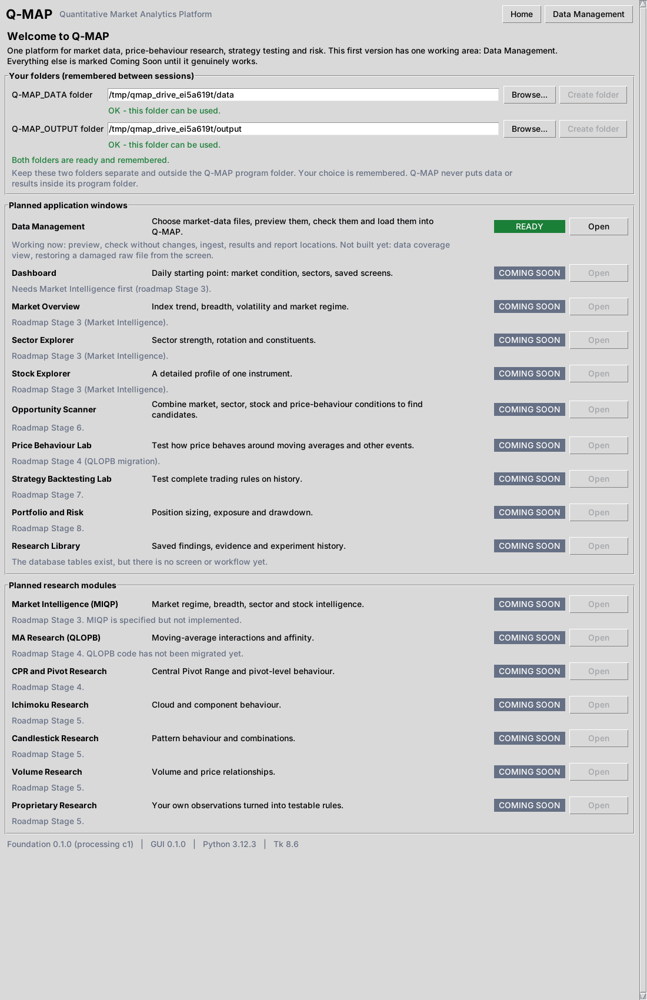
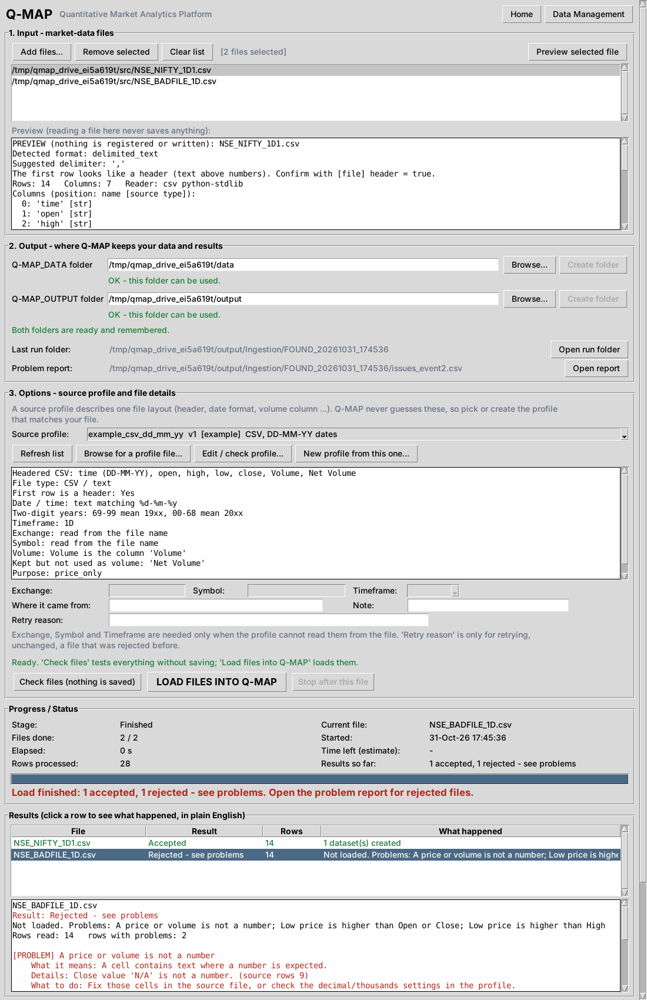

# Q-MAP
Quantitative Market Analytics Platform [Q-MAP]

The governing document is [docs/Q-MAP_Master_Blueprint_v1.0.md](docs/Q-MAP_Master_Blueprint_v1.0.md).
Material decisions are recorded in [docs/decision_log.md](docs/decision_log.md).

## Status: Stage 2 (Foundation) and the first graphical version

Implemented: configuration and path management, structured logging, unique Run IDs and run manifests,
the SQLite registry, raw-data registration with a receipt for every file received, readers for CSV, text,
Excel (.xlsx, optional .xls) and Parquet, explicit source profiles, strict date/time parsing, the canonical
OHLC(V) structure, validation with rejection reports, crash recovery and reprocessing controls.

Also included: a first graphical window (`Q-MAP.py`) with the Data Management workflow. The window is a separate layer
(`Application/qmap_gui`) that only calls the Foundation; the Foundation never depends on it.

Not implemented (later roadmap stages): research modules, backtesting, portfolio and risk.

## Opening the Q-MAP window (first graphical version)

1. Do the one-time setup below (the window also needs `tkinter`, which comes with Python from python.org).
2. Open **`Q-MAP.py`** (in this folder) in **Thonny** or **IDLE** and press **F5**.
   - In Thonny, make sure the interpreter is the Python of your Q-MAP environment: Tools > Options > Interpreter,
     then choose the `python.exe` inside your `<ENV_FOLDER>\Scripts` folder.
   - If something is missing (an old Python, or a package), Q-MAP explains it in a message and, for missing
     packages, offers to install them for you.
3. On first start choose your two folders (**Q-MAP_DATA** and **Q-MAP_OUTPUT**) on the Home screen. Q-MAP checks them
   with the same rules as the Foundation and remembers them in your own user settings (on Windows:
   `%APPDATA%\Q-MAP\gui_settings.json`), never inside the program folder. Your own source profiles are kept
   in a `profiles` folder next to that file.
4. **Data Management** (the one working area) follows the numbered sections on the screen:
   - **1. Input**: add files, preview any of them (nothing is saved by previewing).
   - **2. Output**: your two folders, and buttons to open the last run folder and the problem report.
   - **3. Options**: pick a source profile (its settings are shown in plain English; you can copy an example,
     edit and check it, or browse for a profile file). Type exchange, symbol or timeframe only if the profile
     says it cannot read them from the file.
   - **Check files** tests everything and saves nothing. **Load files into Q-MAP** loads them with the Foundation.
   - Progress, results (click a row for a plain-English explanation of any problem) and a live log are shown below.
5. The Home screen lists every planned module. Only the ones that really work say **READY**; the rest say
   **COMING SOON**.




If you close the window while a load is running, Q-MAP finishes the file it is working on and then stops; the next
start tidies up anything unfinished.

Not in this version: a data-coverage view, restoring a damaged raw file from the screen (use the `restore-raw`
command below), and every module marked Coming Soon.

## Three separate locations

| Location | What it holds | In Git? |
|---|---|---|
| **Code folder** (this repository) | programs, tests, example settings, source profiles | yes |
| **Q-MAP_DATA** | raw files, cleaned datasets, the metadata database, future research repository | never |
| **Q-MAP_OUTPUT** | one folder per run: logs, manifests, rejection reports, later reports and charts | never |

Both data and output folders must already exist, must be **outside** the code folder, and must not be inside
each other. Q-MAP stops with a clear message otherwise.

## One-time setup (Windows commands shown; on macOS/Linux use `bin/python` instead of `Scripts\python.exe`)

You need Python 3.11 or newer. Check with:

```bash
python --version
```

1. Choose a folder for Q-MAP's private Python environment. It must be outside the code folder, Q-MAP_DATA and
   Q-MAP_OUTPUT. Do not move it later (if you must, delete it and repeat steps 2 and 3).
2. Create the environment (replace `<ENV_FOLDER>` with your choice):

```bash
python -m venv "<ENV_FOLDER>"
```

3. Install Q-MAP into it (replace `<CODE_FOLDER>` with this repository's folder):

```bash
"<ENV_FOLDER>\Scripts\python.exe" -m pip install -e "<CODE_FOLDER>"
```

   Only if you need old `.xls` files, also run:

```bash
"<ENV_FOLDER>\Scripts\python.exe" -m pip install -e "<CODE_FOLDER>[xls]"
```

4. Copy `Configuration/qmap.example.toml` to a new file named `qmap.local.toml` (Git ignores it) and set
   `data_root` and `output_root` to your two existing folders.
5. Check that everything works. This installs the test tool and runs all automated tests:

```bash
"<ENV_FOLDER>\Scripts\python.exe" -m pip install -e "<CODE_FOLDER>[dev]"
```

```bash
"<ENV_FOLDER>\Scripts\python.exe" -m pytest "<CODE_FOLDER>"
```

The tests that open real windows need a screen, so they run on a normal Windows/macOS desktop. On a Linux machine
without a screen they are skipped, or can be run with `xvfb-run`. Without `tkinter` they are skipped too.

You never need to "activate" the environment. Use its own `python.exe` as shown. To open IDLE with it:

```bash
"<ENV_FOLDER>\Scripts\python.exe" -m idlelib
```

## Using it

Every file needs a **source profile**: a small settings file that states, for one file layout, everything that
could otherwise be guessed (header or not, date format and unit, time zone, volume columns, instrument,
timeframe). Q-MAP never guesses. Examples are in `Configuration/source_profiles/`; copy one and edit it.
Check every example setting against your own file before use (time zones and two-digit-year rules especially).

Look at a file first. This registers nothing and writes nothing:

```bash
"<ENV_FOLDER>\Scripts\python.exe" -m qmap --config "<CONFIG_FILE>" preview --profile example_csv_unix_seconds --timeframe 1D "<FILE>"
```

Ingest one or more files:

```bash
"<ENV_FOLDER>\Scripts\python.exe" -m qmap --config "<CONFIG_FILE>" ingest --profile example_csv_unix_seconds --timeframe 1D "<FILE>"
```

The result is `ACCEPTED`, `REUSED` (already processed the same way), `REJECTED` (see the issues report named in
the output; nothing is repaired or dropped), `BLOCKED` (retrying an unchanged rejected file needs a written
`--force-reason`) or `UNSUPPORTED` (the reason is shown). Each run's folder in Q-MAP_OUTPUT holds its log,
`run_manifest.json` and any report.

Finish or clean up after a crash, and check every stored file against its checksum:

```bash
"<ENV_FOLDER>\Scripts\python.exe" -m qmap --config "<CONFIG_FILE>" recover
```

```bash
"<ENV_FOLDER>\Scripts\python.exe" -m qmap --config "<CONFIG_FILE>" verify
```

## If a stored raw file turns out to be corrupt

Whenever you ingest content that is already registered, Q-MAP re-reads the stored copy and checks its SHA-256
against the registered checksum (file size alone is never trusted). If they differ:

- the ingest is reported as `FAILED` with the code `E_RAW_CORRUPT`, nothing is processed, and the stored file is
  **not** used, overwritten or deleted;
- the problem is recorded in the audit trail, and `verify` lists the file under `checksum_mismatches`.

To fix it you need the original, unmodified file (the one you were just ingesting matches the registered checksum, so
it qualifies). Restore explicitly, with a written reason (use the dataset number from the message):

```bash
"<ENV_FOLDER>\Scripts\python.exe" -m qmap --config "<CONFIG_FILE>" restore-raw --dataset-id <NUMBER> --from "<ORIGINAL_FILE>" --reason "<why this is correct>"
```

Q-MAP refuses if the reason is missing, if the file does not match the registered checksum, or if the stored file is
intact. On success the corrupt copy is **moved** to `Q-MAP_DATA/Raw_Data/_quarantine` (kept as evidence, never
deleted), the original is put back, and the restore is recorded next to the earlier failure. After a crash during a
restore, run `recover`, then ingest the original again.

## What the foundation guarantees

- Original files are never changed. Identical content is stored once (whatever its name or extension) and every
  receipt is still recorded with its own filename, path, time and source.
- Raw files are never overwritten or automatically deleted, and a stored raw file is checksum-verified before every reuse.
- Invalid data is reported, never repaired or discarded. A rejected file leaves an audit trail.
- Dates, timestamp units, time zones, instrument identity and volume mapping are declared, never guessed.
- Missing volume does not invalidate OHLC data unless the requirement set says volume is required.
- Each cleaned dataset records its profile version, processing-code version and lineage back to the raw file.
- Preserved extra columns (`x_...`) are not quantitative inputs; use `read_quant_columns` to read only the inputs.

## Known limitations (Stage 2)

- Automated tests were run on Linux. Windows-specific file handling is covered by simulation, not by a Windows run.
- Very long folder names can exceed Windows' 260-character path limit; keep the data and output roots short.
- The graphical window covers Data Management only. It has been exercised on Linux (real windows on a virtual
  screen), **not yet on Windows**: Windows-only behaviour (opening folders, remembered-settings location, high-DPI
  text) is covered by simulation. The command line remains for `recover`, `verify` and `restore-raw`.
- Selecting the "current" dataset across several raw files for one instrument is not defined yet.
- Re-receiving registered content re-reads the stored copy to verify it, so very large files take correspondingly longer.
