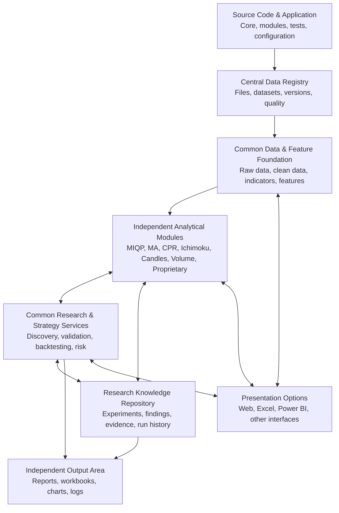
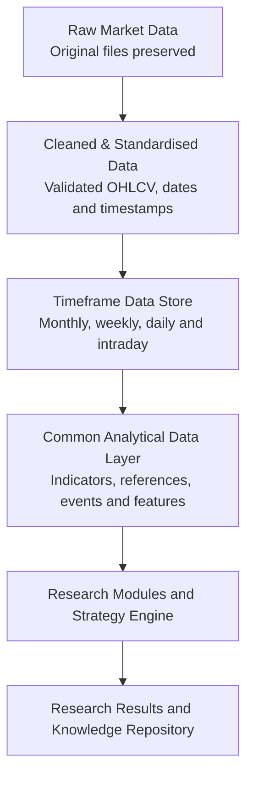
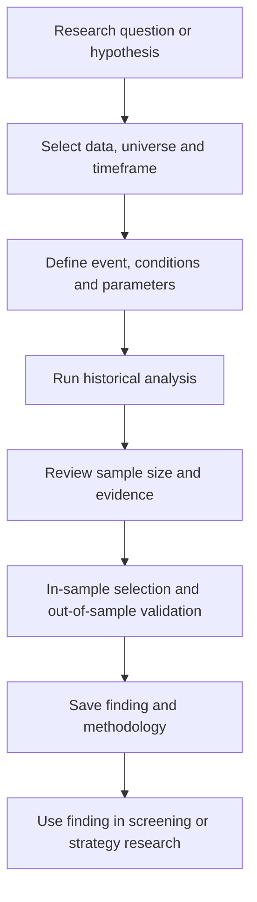

# Q-MAP

## Quantitative Market Analytics Platform

### Master Project Intent, Requirements & Architecture Blueprint

**Document version:** 1.0  
**Status:** Initial consolidated baseline — for owner review and approval  
**Prepared:** 31 October 2026  
**Document purpose:** Explain what Q-MAP is intended to do, how its parts fit together, how it should be used, and the principles that should guide future development.

>
> **In plain English:** Q-MAP is one integrated quantitative research platform. It brings together market intelligence, price-behaviour research, opportunity discovery, strategy backtesting and portfolio-risk analysis. New research ideas and timeframes can be added over time without rebuilding the platform.
>

---

## How to read this document

This is the main intent and architecture reference for Q-MAP. It is deliberately written in plain English rather than as a detailed software engineering specification.

- **Existing** means functionality found in the supplied QLOPB source files.
- **Previously specified** means functionality described in the supplied MIQP documents, but not necessarily implemented.
- **Proposed** means a recommended part of the future Q-MAP design.
- **Open decision** means the owner must decide before the relevant implementation is finalised.

The document describes the target platform. It does not claim that all proposed features already exist.

## Contents

1. [Executive overview](#1-executive-overview)
2. [Why Q-MAP is being created](#2-why-q-map-is-being-created)
3. [What the platform should answer](#3-what-the-platform-should-answer)
4. [The overall platform](#4-the-overall-platform)
5. [Application windows and how they are used](#5-application-windows-and-how-they-are-used)
6. [Independent research modules](#6-independent-research-modules)
7. [How modules share and reuse work](#7-how-modules-share-and-reuse-work)
8. [Data architecture and timeframes](#8-data-architecture-and-timeframes)
9. [Source code, data and output separation](#9-source-code-data-and-output-separation)
10. [Research workflow and backtesting](#10-research-workflow-and-backtesting)
11. [Front-end choices](#11-front-end-choices)
12. [Technology direction in plain English](#12-technology-direction-in-plain-english)
13. [Research integrity and quality controls](#13-research-integrity-and-quality-controls)
14. [How existing QLOPB and MIQP work will be carried forward](#14-how-existing-qlopb-and-miqp-work-will-be-carried-forward)
15. [Development roadmap](#15-development-roadmap)
16. [Project governance and working principles](#16-project-governance-and-working-principles)
17. [Open decisions](#17-open-decisions)
18. [Glossary](#18-glossary)


---

# 1. Executive overview

Q-MAP stands for **Quantitative Market Analytics Platform**.

It is intended to become a personal, extensible research environment for studying historical market data, discovering repeatable price behaviour, identifying trading opportunities and testing whether those observations can support practical trading strategies.

Q-MAP brings together two existing bodies of work:

- **MIQP — Market Intelligence & Query Platform:** the market-wide view of indices, market regime, breadth, sectors, relative strength and stock intelligence.
- **QLOPB — Quant Lens on Price Behaviour:** the focused study of how price behaves around moving averages and other technical reference points.

They should become two major analytical capabilities within one platform, rather than two separate applications.

The platform should also support future research modules such as Ichimoku, candlestick behaviour, volume-price analysis, opening-range behaviour and the owner's own proprietary observations.

### The four central questions


| Question                                                       | Q-MAP capability                     |
|----------------------------------------------------------------|--------------------------------------|
| Where should I look?                                           | Market and sector intelligence       |
| What price behaviour should I investigate?                     | Price-behaviour and research modules |
| Does the observation translate into a viable trading strategy? | Strategy backtesting and validation  |
| How should capital and risk be managed?                        | Portfolio and risk analytics         |


### What Q-MAP is — and is not

Q-MAP is a quantitative research and decision-support platform. It is not initially intended to be an automated trading bot or broker execution system.

Its calculations and research results must work without AI. AI may help explain findings, help formulate research questions or assist with documentation, but it must not invent calculations or replace the research engine.

---

# 2. Why Q-MAP is being created

The original projects address related but different needs.


| Existing project | Main question it addresses                                 | Intended role in Q-MAP   |
|------------------|------------------------------------------------------------|--------------------------|
| MIQP             | What is happening across the market, sectors and stocks?   | Market Intelligence      |
| QLOPB            | How has price behaved around a chosen technical reference? | Price Behaviour Research |


Keeping them as unrelated applications would lead to duplicated data handling, calculations, maintenance and research records. Combining every calculation into one tightly connected program would make it difficult to add or change research methods safely.

The preferred approach is therefore:

**One platform, one shared foundation, independent analytical modules and a common way to store and reuse results.**

The modules should be able to operate independently. They should also be able to use another module's approved data or findings when a research question requires it.

---

# 3. What the platform should answer

Q-MAP should support the following types of questions.

### Market questions

- Is the overall market bullish, bearish, sideways or transitioning?
- Is market breadth improving or deteriorating?
- Which sectors are gaining or losing relative strength?
- Is market leadership broadening or narrowing?
- How does the current market compare with earlier periods?

### Stock questions

- Which stocks have strong price structure and relative performance?
- Which stocks are improving or weakening?
- Which stocks are leading their sectors?
- What is the stock's current relationship with important technical references?
- What evidence supports its ranking or classification?

### Price-behaviour questions

- What tends to happen after price touches or crosses a moving average?
- Does the behaviour change when the moving average is rising or falling?
- Does a CPR breakout behave differently in a trending market?
- How do candlestick patterns behave in different market regimes?
- Does an Ichimoku Cloud interaction have a different outcome when other conditions agree?
- Do the owner's proprietary observations have measurable historical support?

### Strategy questions

- What exact entry and exit rules are being tested?
- What would the historical trade record have looked like?
- What are the returns, drawdowns, win rate and expectancy?
- Does the result survive out-of-sample and walk-forward testing?
- Does it remain useful after reasonable costs and execution assumptions?

---

# 4. The overall platform

Q-MAP should be organised into layers. Each layer has a clear responsibility. This keeps the system understandable and allows parts to evolve without forcing a complete redesign.

## 4.1 Overall architecture



The diagram shows the main responsibilities and relationships. It is a conceptual design, not a claim that these components have already been built.

## 4.2 The layers in plain English


| Layer                          | What it does                                                                                |
|--------------------------------|---------------------------------------------------------------------------------------------|
| Application and source code    | Contains the programs, research modules, tests and settings                                 |
| Data registry                  | Records which files and datasets are available, where they are stored and what they contain |
| Data and feature foundation    | Holds standardised market data and commonly used calculated values                          |
| Analytical modules             | Conduct independent market and price-behaviour analysis                                     |
| Research and strategy services | Provide common methods for experiments, validation and trading-strategy tests               |
| Research repository            | Preserves findings, assumptions, evidence and experiment history                            |
| Output area                    | Stores reports and results separately from source code                                      |
| Presentation options           | Allows different front ends to use the same analytical capabilities                         |


## 4.3 Design principles

1. One integrated platform, not two independent end-user applications.
2. Independent research modules, not one monolithic research program.
3. Common data definitions and calculation standards.
4. Reuse existing data, features and findings wherever valid.
5. Keep the analytics engine independent of the front-end interface.
6. Keep source code, data and generated outputs physically separate.
7. Support additional research methods and timeframes without redesigning the foundation.
8. Make calculations and findings explainable and reproducible.
9. Build only the complexity that is justified by actual needs.


---

# 5. Application windows and how they are used

The application should present a coherent set of windows. These are functional areas, not necessarily separate programs.

## 5.1 Dashboard — daily starting point

**Purpose:** Give a concise view of the market and highlight where attention may be useful.

Expected content:

- Major indices and their current market condition.
- Market regime and breadth.
- Strongest and weakest sectors.
- Volatility context.
- Stocks meeting saved screening criteria.
- Recent research results and important data updates.

**Typical use:** Open Q-MAP, understand the broad environment and decide which areas deserve further investigation.

## 5.2 Market Overview

**Purpose:** Examine the market as a whole.

Expected content:

- Index trend and moving-average structure.
- Market breadth, including the percentage of stocks above selected moving averages.
- Advance/decline information and new highs/lows, where data is available.
- Market volatility.
- Market-regime classification.
- Historical market conditions for a selected date.

**Typical use:** Establish whether the broader environment is supportive, mixed or unfavourable for a particular type of trading.

## 5.3 Sector Explorer

**Purpose:** Identify where relative strength and weakness are developing.

Expected content:

- Sector performance over different periods.
- Relative strength against the market.
- Sector trend and breadth.
- Sector rotation and historical comparisons.
- Constituent stocks and their contribution to sector performance.

**Typical use:** Narrow the market to sectors that deserve closer stock-level research.

## 5.4 Stock Explorer

**Purpose:** Provide a detailed profile of one instrument.

Expected content:

- Daily, weekly and other available timeframe charts.
- Price, volume and selected technical references.
- Trend and stage classification.
- Relative performance against the market and sector.
- Relevant saved price-behaviour findings.
- Evidence supporting classifications and rankings.

**Typical use:** Move from a market or sector observation to a detailed assessment of an individual stock.

## 5.5 Opportunity Scanner

**Purpose:** Combine selected market, sector, stock and price-behaviour conditions to identify candidates.

Example conditions:


| Condition                                                       | Potential source         |
|-----------------------------------------------------------------|--------------------------|
| Market regime is bullish                                        | Market Intelligence      |
| Sector is outperforming                                         | Sector Intelligence      |
| Stock has a favourable trend classification                     | Market Intelligence      |
| Price is above a rising moving average                          | Common calculations      |
| Historical pullbacks to that reference have favourable evidence | Price Behaviour Research |
| Volume confirms the condition                                   | Volume Research          |


The user should be able to save screening definitions, adjust conditions and see why each stock qualified.

A single composite score should not hide the underlying evidence. Individual conditions and their contributions must remain visible.

## 5.6 Price Behaviour Lab

**Purpose:** Investigate historical price behaviour and test research hypotheses.

Potential workbenches:

- Moving-average interactions.
- CPR and pivot behaviour.
- Ichimoku Cloud behaviour.
- Candlestick patterns and combinations.
- Volume-price behaviour.
- Breakouts, pullbacks, gaps and other price events.
- Regime-conditioned and sector-conditioned research.
- Proprietary observations.

A typical experiment should define the universe, timeframe, historical period, event or condition, forward-return windows and validation approach. Results should include sample size and evidence, not only a ranking.

## 5.7 Strategy Backtesting Lab

**Purpose:** Test complete trading rules rather than only describe historical price behaviour.

A strategy definition may include:

- Eligible universe.
- Market and sector filters.
- Entry conditions.
- Entry execution assumption.
- Stop-loss and target.
- Exit rules.
- Position sizing.
- Brokerage, taxes, slippage and other relevant costs.
- Portfolio-level constraints.

Expected outputs include an equity curve, trade list, returns, CAGR, drawdown, win rate, expectancy, risk-adjusted measures and robustness results.

A completed price-behaviour study is not automatically a profitable trading strategy. The strategy must be separately defined and tested.

## 5.8 Portfolio and Risk

**Purpose:** Understand the combined risk of positions and strategies.

Potential capabilities:

- Position sizing.
- Risk per trade.
- Sector and instrument concentration.
- Correlation between positions.
- Portfolio exposure.
- Drawdown and risk limits.
- Strategy-level and portfolio-level performance.

This can begin with simulated portfolios. Live portfolio and broker connections are not required for the initial platform.

## 5.9 Research Library

**Purpose:** Preserve the work already completed so that it can be found and reused.

Each saved experiment or finding should record:

- Research ID and title.
- Originating module.
- Research question.
- Universe and timeframe.
- Data period and dataset version.
- Parameters and methodology version.
- Sample size and results.
- In-sample and out-of-sample evidence.
- Status and limitations.
- Related experiments or strategies.

Suggested statuses:


| Status             | Meaning                                                      |
|--------------------|--------------------------------------------------------------|
| Hypothesis         | An idea has been recorded but not tested                     |
| Research complete  | The defined experiment has run                               |
| OOS validated      | The finding has passed the specified out-of-sample checks    |
| Strategy validated | A complete strategy has passed its agreed validation process |
| Superseded         | A later methodology or result replaces this record           |


## 5.10 Data Management

**Purpose:** Manage the information on which all research depends.

Expected capabilities:

- Register and inspect uploaded files.
- Import and update market data.
- Identify duplicates and missing records.
- Review date, price, volume and timestamp quality.
- Maintain instrument and corporate-action information.
- View data coverage by instrument and timeframe.
- Monitor storage, processing and backup status.

---

# 6. Independent research modules

New research ideas must be addable without rebuilding the platform.

## 6.1 Initial module catalogue


| Module               | Main responsibility                                    | Initial status                        |
|----------------------|--------------------------------------------------------|---------------------------------------|
| Market Intelligence  | Market regime, breadth, sectors and stock intelligence | Previously specified in MIQP          |
| MA Research          | Moving-average interactions and affinity               | Existing QLOPB capability             |
| CPR Research         | Central Pivot Range behaviour                          | Planned; reference placeholders exist |
| Pivot Research       | Pivot levels and support/resistance behaviour          | Planned; reference placeholders exist |
| Ichimoku Research    | Cloud, component relationships and price behaviour     | Proposed                              |
| Candlestick Research | Individual patterns and combinations                   | Proposed                              |
| Volume Research      | Volume and price relationships                         | Proposed                              |
| Proprietary Research | Owner-defined observations and hypotheses              | Required extensibility                |
| Future modules       | Any new quantitative research method                   | Extensible by design                  |


## 6.2 What every module should provide

Each module should have a consistent description and operating standard:

1. What question does it investigate?
2. What input data does it require?
3. Which timeframes does it support?
4. Which parameters can the user change?
5. What calculations and events does it produce?
6. What research outputs does it generate?
7. How is its work validated?
8. Which other modules may use its outputs?
9. Which version of the module produced the result?


A module must be independently testable. It should not need to know the internal code of another module.

## 6.3 Example: Adding Ichimoku research

A future Ichimoku module could:

1. Calculate the standard Ichimoku components.
2. Identify price above, below or within the Cloud.
3. Identify Cloud breakouts and interactions.
4. Record relationships between price and the relevant components.
5. Study forward returns after defined events.
6. Compare behaviour under different market regimes and sectors.
7. validate findings on data not used to select the hypothesis.
8. Publish its results to the Research Library.


The same approach applies to a proprietary observation. The observation must first be translated into clear, testable rules. It can then use the common data, research and validation services.

---

# 7. How modules share and reuse work

This is a central feature of Q-MAP.

**Independent does not mean isolated.** Modules should be able to use standardised data and outputs from other modules without depending on their internal implementation.

## 7.1 Example of combined research

Research question:

*What happens when a stock is in Stage 2, above a rising 50-day moving average, above the Ichimoku Cloud and forms a bullish engulfing candle near a selected reference?*


| Information required            | Source                     |
|---------------------------------|----------------------------|
| Stage classification            | Market Intelligence        |
| 50-day moving average and slope | Common Calculation Library |
| Ichimoku Cloud position         | Ichimoku Research          |
| Bullish engulfing event         | Candlestick Research       |
| Subsequent returns              | Common Research Framework  |
| Market-regime condition         | Market Intelligence        |


The common research framework combines the conditions and evaluates the resulting historical observations.

## 7.2 Common calculation library

Standard calculations should be implemented once and reused wherever appropriate.

Examples include:

- Moving averages.
- ATR and volatility.
- CPR and pivot calculations.
- Volume averages.
- Relative strength.
- Standard price and return calculations.
- Timeframe aggregation.

The definition of a calculation must be consistent. If a methodology changes, the new version must be identified rather than silently changing historical results.

## 7.3 Common Feature Store

Q-MAP should retain commonly used calculated values in a reusable analytical store.

For example, the 50-day moving average for an instrument and date should not be recalculated independently by MIQP, QLOPB and every new research module.

The Feature Store should record enough information to identify:

- Instrument.
- Date and timeframe.
- Feature name and value.
- Calculation version.
- Source data version.
- Relevant parameters.

Modules should retrieve the feature when it is valid and current. They should request recalculation when the data or methodology requires it.

## 7.4 Research findings are reusable too

The Research Library stores conclusions and evidence, not just raw calculated values.

For example, a completed study of 30-week moving-average support behaviour can be used by the Opportunity Scanner or a later strategy experiment without rerunning the original research.

The receiving module must still check that the finding applies to its requested universe, timeframe, period and methodology.

---

# 8. Data architecture and timeframes

## 8.1 Data flow



The original uploaded data should be preserved. Cleaning and standardisation should create managed versions rather than silently changing the original file.

## 8.2 Supported timeframes

Q-MAP should be designed to support:


| Timeframe | Typical use                                         |
|-----------|-----------------------------------------------------|
| Monthly   | Long-term structure                                 |
| Weekly    | Positional and trend research                       |
| Daily     | Swing trading and general research                  |
| 4-hour    | Intermediate timeframe research                     |
| 1-hour    | Short-term trading research                         |
| 30-minute | Intraday research                                   |
| 15-minute | Intraday setups                                     |
| 5-minute  | Entry and execution research                        |
| 1-minute  | Detailed intraday research, where data is available |


The architecture should support these timeframes from the beginning. They do not all need to be activated or populated immediately.

Each module must declare the timeframes it supports. A module designed for daily data should not be assumed to work correctly on one-minute data without appropriate validation.

## 8.3 Handling large data volumes

Intraday data can become much larger than daily data. Q-MAP should therefore avoid loading entire historical datasets into memory or placing every raw market record in one database file.

Proposed storage responsibilities:


| Storage component              | Proposed role                                                      |
|--------------------------------|--------------------------------------------------------------------|
| Parquet files                  | Efficient storage of historical and analytical datasets            |
| DuckDB                         | Query and analysis across large Parquet datasets                   |
| SQLite initially               | Application metadata, file registry, settings and research records |
| PostgreSQL later, if justified | Larger multi-user or concurrent operational needs                  |


These are proposed choices. The final design should be confirmed against actual data volumes, access patterns and backup needs.

## 8.4 Data quality and time alignment

The platform should check:

- Missing and duplicate records.
- Invalid or inconsistent OHLC values.
- Date and timestamp formats.
- Exchange sessions and trading calendars.
- Timezone handling.
- Corporate actions and price adjustments.
- Instrument changes and symbol mapping.
- Data coverage and gaps.

Higher-timeframe bars derived from intraday data must follow consistent exchange-session and aggregation rules.

---

# 9. Source code, data and output separation

This is a mandatory operating principle.

The source code, managed data and generated outputs must be stored separately. Running a research experiment must not write reports into the source-code folders or alter the original input data.

## 9.1 Proposed physical organisation

```text
Q-MAP_CODE/  
    Application/  
        Core/  
        Data_Engine/  
        Common_Calculations/  
        Research_Modules/  
        Backtesting/  
        Portfolio_Risk/  
        Interfaces/  
    Tests/  
    Configuration/  
    Documentation/  
  
Q-MAP_DATA/  
    Raw_Data/  
    Cleaned_Data/  
    Timeframe_Data/  
    Reference_Files/  
    Feature_Store/  
    Research_Repository/  
    Metadata/  
  
Q-MAP_OUTPUT/  
    Backtesting/  
    Research_Reports/  
    Excel_Exports/  
    PDF_Reports/  
    Charts/  
    Logs/
```

These can reside on different drives or storage locations. The actual paths should be configurable.

## 9.2 Run management

Every execution should receive a unique Run ID and a separate output location.

For example:

```text
Q-MAP_OUTPUT/  
Backtesting/  
BT_20261031_001/  
Run_Summary.xlsx  
Trade_Log.xlsx  
Equity_Curve.png  
Run_Metadata.json  
Execution_Log.txt
```

The exact files depend on the experiment.

A completed run should not silently overwrite an earlier run. If the same experiment is repeated, the system should either retrieve the existing valid result or create a new versioned run.

---

# 10. Research workflow and backtesting

Q-MAP must distinguish between discovering a historical relationship and testing a complete trading strategy.

## 10.1 Research workflow



## 10.2 Price-behaviour research

Example: study how price behaves when it interacts with a rising 30-week moving average.

The study could measure:

- Number of qualifying interactions.
- Positive and negative outcomes.
- Average and median forward returns.
- Return distribution.
- Favourable and adverse price movement, where defined.
- Differences across market regimes.
- In-sample and out-of-sample consistency.

The output describes historical behaviour. It does not by itself prove that a profitable trading strategy exists.

## 10.3 Strategy backtesting

A complete strategy test must define the actual trading rules.

Example:


| Rule            | Illustrative definition           |
|-----------------|-----------------------------------|
| Universe        | Selected stock universe           |
| Market filter   | Bullish regime                    |
| Sector filter   | Sector outperforming              |
| Stock filter    | Defined trend condition           |
| Entry           | Defined pullback and confirmation |
| Execution       | Next eligible trading session     |
| Stop-loss       | Defined ATR-based rule            |
| Target          | Defined reward-to-risk rule       |
| Position sizing | Fixed portfolio risk per trade    |
| Exit            | Stop, target or time-based rule   |


These are example rules, not a validated trading system.

## 10.4 Validation requirements

Backtesting should address:

- Chronological in-sample and out-of-sample separation.
- Walk-forward testing.
- Look-ahead bias.
- Survivorship bias and historical constituent coverage.
- Corporate actions and adjusted prices.
- Brokerage, taxes, slippage and execution assumptions.
- Overlapping signals and portfolio constraints.
- Sensitivity to parameter changes.
- Detailed trade-level records.

A strategy should not be labelled validated simply because its historical return is attractive.

---

# 11. Front-end choices

The analytical engine should be independent of the user interface.

Python should perform the calculations, research, validation and backtesting. The front end should request work, display results and provide user controls.

## 11.1 Possible interfaces


| Interface               | Potential use                                         |
|-------------------------|-------------------------------------------------------|
| HTML/web application    | Main interactive research platform                    |
| Excel                   | Detailed result inspection, comparison and exports    |
| Power BI                | Market, sector and historical dashboards              |
| Desktop interface       | Local application experience, if preferred            |
| Other future interfaces | Can be added through the common application interface |


More than one interface may be used at the same time.

## 11.2 Common application interface

A common interface should allow front ends to:

- Request a dataset or analytical result.
- Submit a research or backtesting job.
- Check job status.
- Retrieve results.
- Export reports.
- Access permitted settings and metadata.

A Python API layer, potentially using FastAPI, is a suitable option. The final web framework and front-end choice remain open.

**Important:** Excel and Power BI should generally consume published results or approved data interfaces. They should not contain separate copies of the core research calculations.

---

# 12. Technology direction in plain English

The following is a practical starting direction, not a requirement to use every tool immediately.


| Area                        | Proposed choice             | Why it is useful                                              |
|-----------------------------|-----------------------------|---------------------------------------------------------------|
| Main development language   | Python                      | Common language for all analytical modules                    |
| Data manipulation           | Pandas; Polars where useful | Clean and analyse market data                                 |
| Historical data storage     | Parquet                     | Efficient storage of large datasets                           |
| Analytical query engine     | DuckDB                      | Analyse large datasets without loading everything into memory |
| Metadata database           | SQLite initially            | Store settings, registries and research records simply        |
| Larger operational database | PostgreSQL if justified     | Support more demanding multi-user needs                       |
| Application interface       | FastAPI or equivalent       | Allow different front ends to use the same engine             |
| Charts                      | Plotly or equivalent        | Interactive financial charts                                  |
| Testing                     | Pytest or equivalent        | Verify calculations and prevent regressions                   |
| Code management             | Git                         | Track code changes and preserve versions                      |


The design should favour simple, dependable solutions. Additional infrastructure should be introduced only when the actual workload requires it.

---

# 13. Research integrity and quality controls

The platform's usefulness depends on the quality of its data, calculations and methodology.

The following rules should apply across all modules.

1. **Deterministic calculations:** The same inputs, parameters and code version should produce the same results.
2. **Independent verification:** Important calculations should be independently checkable, not hidden behind a dashboard.
3. **Visible evidence:** Scores and rankings should show their underlying factors and supporting observations.
4. **No look-ahead:** Historical calculations must use only information available at the time being tested.
5. **No silent data changes:** Original input files remain preserved; cleaned data is separately identifiable.
6. **Versioned methodology:** Changes to formulas or event definitions must be recorded.
7. **Appropriate validation:** Research selection and final validation must use separate historical observations.
8. **Honest status labels:** Insufficient evidence must not be presented as a negative result or as proof of failure.
9. **Costs and execution:** Strategy tests must state their execution and cost assumptions.
10. **AI independence:** The platform's core calculations must work without AI.


## 13.1 Reusing work without repeating it

Q-MAP should include a Research Run Manager and a result-reuse mechanism.

When an experiment is requested, the system should check whether an equivalent result already exists.

It should compare:

- Dataset and data version.
- Instrument universe.
- Timeframe and date range.
- Module and code version.
- Calculation methodology.
- Research parameters.

If all relevant inputs match, an existing result may be reused.

If data, methodology or parameters have changed, the system should create a new run or recalculate the affected information.

Incremental processing should be used where practical. For example, when new daily data arrives, the system should calculate the new affected periods rather than unnecessarily rebuilding every historical feature.

A reused result must retain its original Run ID and provenance. The system must not make an old result appear to have been generated using newer data or code.

---

# 14. How existing QLOPB and MIQP work will be carried forward

The new platform is a fresh project baseline, not a decision to discard the existing work.

## 14.1 QLOPB

The supplied QLOPB repository contains a modular Python application, data handling, timeframe preparation, reference calculations, interaction and affinity analysis, validation, reports, a desktop interface and tests.

The supplied README identifies MA Affinity as the implemented research capability. Several other reference and combination areas are placeholders.

Proposed treatment:


| Existing capability               | Q-MAP treatment                                                      |
|-----------------------------------|----------------------------------------------------------------------|
| Data loading and validation       | Review and reuse                                                     |
| Timeframe engine                  | Review and reuse                                                     |
| Moving-average calculations       | Reuse after definition checks                                        |
| Interaction and affinity research | Preserve as Price Behaviour module                                   |
| IS/OOS validation                 | Review, retain and strengthen                                        |
| Pivot and CPR placeholders        | Complete within independent modules                                  |
| Reporting                         | Reuse useful report logic                                            |
| Existing GUI                      | Preserve during migration; replace or adapt after front-end decision |
| Tests                             | Retain and run as migration checks                                   |


The supplied QLOPB project notes identify methodology items requiring owner review, including Directed IR, scoring weights and boundary handling. These should be resolved before the relevant methodology is treated as final.

## 14.2 MIQP

The supplied MIQP material contains extensive concepts, principles, technology choices, database specifications, phase specifications, feature definitions, decisions and project logs.

It provides a useful design foundation for Market Intelligence and the wider platform.

However, the supplied archive is primarily documentation and inventory material; it does not establish that the full MIQP application has been implemented.

Proposed treatment:


| Existing MIQP work                     | Q-MAP treatment                                               |
|----------------------------------------|---------------------------------------------------------------|
| Market intelligence concepts           | Retain and incorporate                                        |
| Market regime and breadth definitions  | Review and implement                                          |
| Sector and stock intelligence          | Retain as a major module                                      |
| Database and data specifications       | Reconcile with the expanded data architecture                 |
| Dashboard concepts                     | Use as input to the front-end design                          |
| Core principles                        | Incorporate where consistent with the integrated architecture |
| Older inventory and planning documents | Reconcile and archive where superseded                        |


## 14.3 Migration rule

The original QLOPB and MIQP project archives should remain preserved as reference baselines.

Q-MAP should be established as the new parent project. Existing code should be migrated incrementally, not rewritten by default.

Before a component is accepted into Q-MAP, its purpose, behaviour, tests, dependencies and known limitations should be reviewed.

---

# 15. Development roadmap

The roadmap should be staged. The objective is to establish a reliable foundation before adding a large number of research modules.


| Stage                      | Main work                                                                                | Expected outcome                        |
|----------------------------|------------------------------------------------------------------------------------------|-----------------------------------------|
| 1. Blueprint and decisions | Approve scope, architecture, data rules and front-end direction                          | Agreed Q-MAP baseline                   |
| 2. Foundation              | Establish code structure, data registry, storage, common calculations and run management | Reusable platform foundation            |
| 3. Market Intelligence     | Implement market, sector and stock intelligence                                          | MIQP capability in Q-MAP                |
| 4. Price Behaviour         | Migrate MA research and add CPR/pivot research                                           | QLOPB capability in Q-MAP               |
| 5. Extensible research     | Add module standards and initial new modules such as Ichimoku and candlesticks           | New research can be added independently |
| 6. Integrated screening    | Combine market and price-behaviour findings                                              | Opportunity Scanner                     |
| 7. Strategy research       | Implement common backtesting and validation                                              | Complete strategy testing               |
| 8. Portfolio and risk      | Add position and portfolio-level analysis                                                | Risk-aware decision support             |
| 9. Additional scale        | Add intraday datasets, performance improvements and further modules as justified         | Expanded research capability            |


Some capabilities can be developed in parallel once their shared definitions and interfaces are agreed.

## 15.1 What should be built early

The following should be foundational rather than postponed:

- Separate code, data and output locations.
- Data registry and dataset versioning.
- Common instrument and timeframe definitions.
- Common calculation library.
- Research module standards.
- Run ID and experiment history.
- Research result provenance.
- Basic data-quality checks.
- Automated tests.

The choice of front end can remain open while the Python analytics and common application interface are designed independently.

---

# 16. Project governance and working principles

These rules should guide future discussions, development and changes.

## 16.1 Owner approval

The platform owner approves material decisions involving scope, research methodology, architecture, data policy and front-end selection.

## 16.2 Documentation before material changes

A material change should be described in the Master Blueprint or its supporting specifications before implementation. Small implementation details do not need to interrupt the main document.

## 16.3 Change history

Each material decision should record:

- Decision reference and date.
- What was previously proposed.
- What has changed.
- Why it changed.
- Which modules or documents are affected.
- Approval status.

## 16.4 Development and testing

A new module should include its own tests and documentation. Changes to shared calculations should trigger regression testing of the modules that use them.

## 16.5 No unnecessary rewrites

Working, tested code should be reused where it fits the agreed architecture. Rewriting should have a clear benefit and a controlled migration plan.

## 16.6 No hidden dependencies

A research module should declare what data, features and services it needs. It should not rely on another module's private internal code or silently modify its outputs.

---

# 17. Open decisions

The following decisions remain open and should be resolved at the appropriate stage.


| Decision                                            | Current position                                                                         |
|-----------------------------------------------------|------------------------------------------------------------------------------------------|
| Final front-end technology                          | Owner to choose; architecture remains independent                                        |
| Final physical storage locations                    | To be configured                                                                         |
| Initial active timeframe coverage                   | Daily and weekly are practical starting points; intraday is supported by design          |
| Intraday data source and retention                  | To be decided                                                                            |
| Final database arrangement                          | Parquet, DuckDB and SQLite are proposed; validate against workload                       |
| Market universe and historical constituent coverage | Confirm data availability and scope                                                      |
| Corporate-action adjustment policy                  | Define source, treatment and validation                                                  |
| Final MIQP market-regime methodology                | Review and approve                                                                       |
| QLOPB Directed IR and affinity methodology          | Resolve outstanding owner-review items                                                   |
| Initial new research modules                        | Prioritise after the foundation is stable                                                |
| AI assistance                                       | Optional interpretation and research support; deterministic engine remains authoritative |
| Broker connectivity and automated execution         | Outside the initial scope; consider separately if ever required                          |


An open decision is not a defect. It is better to record it clearly than to make an assumption that later becomes difficult to reverse.

---

# 18. Glossary


| Term                   | Plain-English meaning                                                                                                      |
|------------------------|----------------------------------------------------------------------------------------------------------------------------|
| OHLCV                  | Open, High, Low, Close and Volume market data                                                                              |
| Instrument             | A stock, index, ETF or other market-traded item                                                                            |
| Timeframe              | The period represented by each price bar, such as daily or five-minute                                                     |
| Feature                | A calculated value used for analysis, such as a moving average or ATR                                                      |
| Feature Store          | A shared place where reusable calculated values are kept                                                                   |
| Research module        | An independent part of Q-MAP that investigates a particular market question                                                |
| Event                  | A defined historical occurrence, such as a price crossing a moving average                                                 |
| Forward return         | The price return measured after a defined historical event                                                                 |
| In-sample              | Historical data used to develop or select a hypothesis or strategy                                                         |
| Out-of-sample          | Separate historical data used to test whether the selected result holds up                                                 |
| Walk-forward testing   | Repeating the development and testing process through successive historical periods                                        |
| Backtesting            | Simulating a defined trading strategy on historical data                                                                   |
| Drawdown               | A fall from a previous portfolio or strategy equity peak                                                                   |
| Provenance             | A record of where data or a result came from and how it was produced                                                       |
| Run ID                 | A unique reference for one execution of a research or backtesting task                                                     |
| Incremental processing | Updating only the data or calculations affected by new information                                                         |
| Look-ahead bias        | Accidentally using information that would not have been available at the historical decision time                          |
| Survivorship bias      | Testing only instruments that survived or remain in today's universe, potentially excluding failed or delisted instruments |
| Research finding       | A recorded conclusion supported by a defined experiment and its evidence                                                   |


---

# Closing statement

Q-MAP should be built as a long-term quantitative research environment, not as a fixed collection of indicators or a one-purpose trading scanner.

Its value should increase as more historical data is registered, more research modules are added, more findings are validated and more of the previous work becomes reusable.

The guiding idea is simple:

**Build the foundation once. Add research capabilities independently. Share valid data and findings. Preserve every experiment. Make the results understandable and independently verifiable.**

This document is the consolidated starting point for that work. It should evolve through controlled, recorded changes as Q-MAP moves from design into implementation.

 
